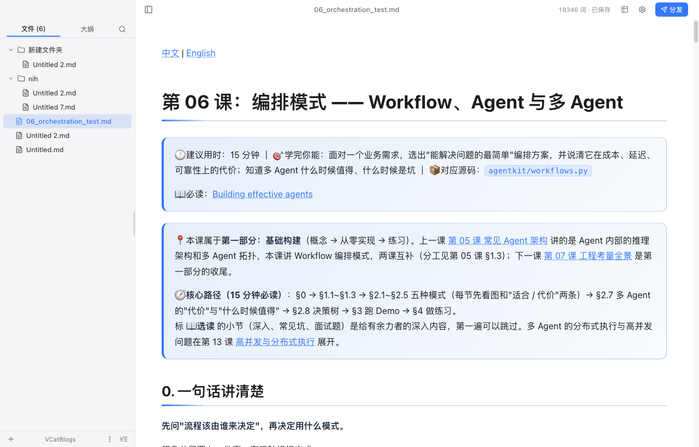
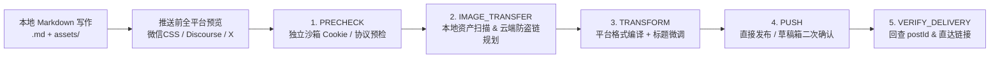

<div align="center">

# Vmark（维记）

### Local-First（本地优先）Markdown 创作与多平台合规分发桌面工作台

**`V`（Verified · 翼标）+ `Mark`（Markdown · 书签印记）：一个纯粹、离线优先、支持 24 套 Bloom 主题与自定义 CSS 的桌面端 Markdown 编辑器，打通本地写作、图片资产管理与多平台（小红书、微信公众号、Linux.do、X、博客园等）合规发布。**

[](LICENSE)
[](#系统架构与-5-步送达管线)
[](#项目结构monorepo)
[](#自己如何独立打开-vmark维记)
[](#支持平台与真实发布策略直发--二次确认--后续调用)

[快速启动](#-自己如何独立打开-vmark维记) · [研发分支与 CI/CD 规范](#-研发分支流程与-github-cicd-自动化规范) · [界面预览](#-界面实拍预览) · [第二阶段发布规划](docs/02-design/phase2-publish-plan.md) · [草稿反向导入与独立管理方案](docs/02-design/platform-import-and-draft-management-plan.md) · [常见问题 FAQ](#-常见问题-faq)

</div>

---

## 🔄 研发分支流程与 GitHub CI/CD 自动化规范

> 新功能开发一律不直接在 `master` 生产分支修改，严格遵循以下三分支协同流程与自动化门禁：

```
master (生产分支) ── checkout ──▶ feature-xxxx-YYYYMMDD (功能分支) ── merge ──▶ test (测试分支)
       ▲                                    │
       └────────────── PR 审核 + CI 全绿 merge ┘
```

1. **三类分支职责**
   - `master`（生产分支）：始终保持可随时打包发布的稳定基线；**禁止直接 push 脏改动**，只接受来自功能分支通过 PR + CI 校验后的合并。
   - `feature-xxxx-YYYYMMDD`（功能分支，如 `feature-weixin-publish-20261117`）：每次开发新需求从 `master` 切出，独立开发并本地跑通校验。
   - `test`（测试集成分支）：需要联调或提测时，将功能分支合并到 `test` 进行集中验证。

2. **GitHub CI/CD 是干嘛的？（已配好开箱即用）**
   - **CI（持续集成 · 自动体检）**：配置在 [.github/workflows/ci.yml](.github/workflows/ci.yml)。每当你向 `feature-*`、`test` 或 `master` 推送代码或发起 Pull Request（PR）时，GitHub 服务器会自动运行 `pnpm typecheck`、`pnpm test`、`pnpm --filter @vcat/desktop build` 以及 **Playwright 真实浏览器 E2E 测试**。只要有任意一项红叉，PR 页面会直接拦截，防止把 Bug 合进 `master`。
   - **CD（持续交付 · 自动打包）**：配置在 [.github/workflows/release.yml](.github/workflows/release.yml)。当 `master` 确认无误后，在本地打一个版本标签并推送（如 `git tag v0.2.0 && git push origin v0.2.0`），GitHub Actions 会自动在云端 macOS 环境编译并生成 `.dmg` / `.zip` 安装包上传到 GitHub Releases。

3. **标准日常操作速查**
   ```bash
   # 1. 从最新 master 切出功能分支
   git checkout master && git pull origin master
   git checkout -b feature-weixin-publish-20261117

   # 2. 开发完成并本地跑通校验后推到远程，再合并到 test 分支联调
   git push -u origin feature-weixin-publish-20261117
   git checkout test && git merge feature-weixin-publish-20261117 && git push origin test

   # 3. 测试无误后，在 GitHub 发起 feature -> master 的 PR，等待 CI 全绿后 Merge
   # 4. 需要发版时打 tag 自动触发 CD 打包
   git checkout master && git pull origin master
   git tag v0.2.0 && git push origin v0.2.0
   ```

4. **第二阶段规划入口**：编辑器基线已通过 Playwright E2E 回归，第二阶段聚焦：
   - **[多平台发布与分发效果规划](docs/02-design/phase2-publish-plan.md)**（微信公众号草稿箱 + 内联 CSS 渲染 + 图床与防盗链转存）。
   - **[平台草稿反向导入与本地独立管理方案](docs/02-design/platform-import-and-draft-management-plan.md)**（真实沙箱工作台 + 草稿单向拉取导入 + 本地 Markdown 独立管理，切断云端双向绑定）。

---

## 🎯 什么是 Vmark（维记）？解决什么问题？

**Vmark（维记）** 是一款专为独立博主、技术作者与多平台创作者打造的 **Local-First（本地优先）桌面端 Markdown 写作与分发工作台**（macOS / Windows）。

写完一篇图文、代码与流程图并茂的技术长文后，创作者往往要反复折腾图床防盗链、切换多个网页后台粘贴排版、面对“不知道发没发成功”的焦虑。Vmark 将整条创作链路收拢进一个本地目录工作区：

1. **所见即所得（IR）沉浸写作**：单层无闪烁代码块编辑、原生 `CSS.highlights` 实时语法着色（`.txt` 等纯文本自动豁免）、KaTeX 数学公式渲染、Mermaid 流程图高亮与全屏高清灯箱（支持空格键切换、滚轮缩放、360° 顺时针旋转）。
2. **高度可定制视觉体验**：默认 Apple Light，内置 24 套 Bloom 明暗双态主题，并在设置中开放**自定义 CSS 样式文件导入入口**。
3. **本地目录即工作区**：所有 `.md` 文章与 `./assets/` 图片永久保存在你自己的本地文件夹，断网 100% 可用，支持 `Shift` 区间多选批量删除、全文搜索、Markdown / Word（`.docx`）/ 独立 HTML / PDF 导出。
4. **独立沙箱合规分发**：按平台风控等级区分“直发”、“草稿箱人工二次确认”与后续自动化 API 调用扩展，保护账号安全与本地源文件零污染。

---

## 📸 界面实拍预览

| 白色沉浸写作与大纲/文件树 | 暗黑 Bloom 主题与流程图/代码高亮 | 本地文章管理台与统计视图 |
| :---: | :---: | :---: |
|  |  |  |

---

## ⚖️ 为什么需要 Vmark（维记）？

| 对比维度 | 传统散装写作（编辑器 + 手动图床 + 多标签页后台） | Vmark（维记）桌面工作台 |
| :--- | :--- | :--- |
| **数据归属** | 依赖云端平台或杂乱草稿，换平台即丢失格式 | **100% Local-First**：标准 `.md` + 本地 `./assets/`，随时 Git 备份 |
| **代码块与流程图** | 多层预览切换闪烁、暗黑流程图连线看不清 | **单层直编零闪烁** + `CSS.highlights` 着色 + 空格秒开高清灯箱 |
| **多平台适配** | 每次手工复制粘贴、逐一调整排版与图片 | **统一预览与分级推送**：直发 / 草稿二次确认 / 后续调用扩展 |
| **导出与迁移** | 格式锁定或导出残缺 | 一键导出 **Markdown / Word (`.docx`) / HTML / PDF**，支持自定义复制格式 |
| **工程规范** | 单文件臃肿、耦合严重 | **pnpm workspace + Turborepo**，严格执行 500–600 行单文件解耦规范 |

---

## 🌐 支持平台与真实发布策略（直发 / 二次确认 / 后续调用）

Vmark 务实区分各内容平台的风控机制与接口能力，**不搞虚假自动化**：

| 分发策略 | 适用平台示例 | 实际落地方式与当前边界 |
| :--- | :--- | :--- |
| **直接发布 / 选板块直发** | **Linux.do (Discourse)**、**博客园 (MetaWeblog)**、**GitHub 静态博客** | 接口稳定、支持直接发布或触发 Git CI/CD，发布后自动回查链接 |
| **草稿箱 + 人工二次确认** | **小红书**、**微信公众号**、**X (Twitter)**、**知乎 / 掘金 / CSDN / B站** | 考虑到小红书与主流自媒体平台风控严格，默认推送至草稿箱或独立沙箱环境，保留**人工二次确认**再点击最终发布 |
| **后续 API / 自动化调用** | 扩展平台与云端防盗链图床（OSS/COS/S3） | 随 Phase 3 演进逐步通过标准化适配器与云端存储接口接入调用 |

### 完整生态覆盖（30+ 平台目录）

- **高频主力平台**：小红书、微信公众号、X (Twitter)、Linux.do、博客园 (Cnblogs)、稀土掘金、B 站专栏、抖音图文
- **技术与资讯社区**：CSDN、SegmentFault 思否、开源中国 (OSChina)、阿里云开发者社区、51CTO、语雀、知乎、百家号、微博头条文章、今日头条号、简书、豆瓣、搜狐号、网易号、大鱼号、一点号
- **财经产品与自建站**：雪球、东方财富、人人都是产品经理、什么值得买、WordPress、Typecho、Hexo / Hugo

---

## 🚀 自己如何独立打开 Vmark（维记）

Vmark 仓库全部使用 **`pnpm`** 管理依赖（请勿混用 `npm` 或 `yarn`）。你可以通过以下任意一种方式自己独立打开软件：

### 方式一：Finder 双击一键启动（最简单）

1. 打开项目根目录：`/Users/leileigwl/Desktop/aa/vcat-publisher-desktop`
2. 直接双击文件夹里的 **[`启动Vmark.command`](启动Vmark.command)**，系统会自动打开终端并弹出 **Vmark（维记）** 桌面窗口。

### 方式二：终端命令行启动

```bash
# 1. 进入项目目录
cd /Users/leileigwl/Desktop/aa/vcat-publisher-desktop

# 2. 首次运行（如未安装依赖）执行：
pnpm install

# 3. 启动 Vmark 桌面应用（开发模式，带热更新）
pnpm dev
```

> **仅运行构建后的本地预览版**：可先执行 `pnpm --filter @vcat/desktop build`，再在 `apps/desktop` 目录下通过 Electron 加载 `out/main/index.js`。

---

## ⚙️ 系统架构与 5 步送达管线



---

## 📂 项目结构（Monorepo）

采用 **`pnpm workspace + Turborepo`** 组织工程，并严格遵循 **单文件不超过 500–600 行** 的模块化拆分规范：

```text
vcat-publisher-desktop/
├── apps/
│   └── desktop/                  # Electron + Vite + React 18 桌面端外壳
│       └── src/renderer/src/
│           ├── editor/           # 解耦后的语法高亮、表格矩阵、行内格式模块
│           ├── components/       # UI 组件（含 sidebar/ 独立子模块）
│           └── styles/           # 拆分后的 themes.css / editor.css / mermaid.css
├── packages/
│   ├── shared/                   # 全局 TypeScript 契约、偏好设置与接口定义
│   ├── core/                     # 本地目录扫描、大纲/字数统计、表格矩阵引擎
│   ├── image-pipeline/           # 图片扫描与本地 assets/ 管理管线
│   └── adapters/                 # 30+ 平台分级发布适配器接口
├── docs/                         # 架构规范、产品文档、交接记录与实拍截图
├── openspec/                     # Spec-Driven Development 规格与变更提案
└── 启动Vmark.command             # macOS 双击一键启动脚本
```

---

## ❓ 常见问题 FAQ

- **Q：Vmark（维记）和传统在线博客后台有什么区别？**  
  A：Vmark 是本地优先（Local-First）的桌面应用，文章与图片默认存储在你自己的磁盘目录中，断网可用，不存在平台倒闭或编辑器吞稿风险；同时兼顾多平台预览、`.md`/`.docx`/`.html`/`.pdf` 导出与分级分发。
- **Q：如何加载自己的 CSS 主题？**  
  A：打开「偏好设置（`Cmd+,`）→ 外观主题 → 导入自定义 CSS 样式文件」，即可加载任意 `.css` 覆盖 `--bg-main`、`--text-main`、`--accent` 等 CSS 变量与 `.vditor-reset` 排版样式。
- **Q：小红书等平台会全自动无人值守发布吗？**  
  A：不会盲目全自动刷发。小红书、公众号等平台默认采用独立沙箱推送至草稿箱并保留**人工二次确认**，兼顾效率与账号合规安全。

---

## 📋 当前研发进度

- [x] **Phase 0（规范与原型门控）**：完成 `OpenSpec` 立项、参考仓调研与交互原型。
- [x] **Phase 1**：搭建 `pnpm + Turborepo` Monorepo 脚手架与 Electron 本地工作区引擎。
- [x] **Phase 2**：落地所见即所得 IR 编辑器、24 套 Bloom 主题与自定义 CSS 入口、KaTeX 公式、Mermaid 灯箱、多格式导出（MD/DOCX/HTML/PDF）及 500–600 行模块解耦规范。
- [ ] **Phase 3**：落地云端防盗链存储方案、SQLite `sync_records` 持久化与多平台适配器调用。
