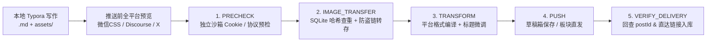

<div align="center">

# VCat Publisher Desktop

**面向独立博主与技术创作者的 Local-First（本地优先）桌面端写作与 30+ 平台合规分发工作台**

*纯正 Typora 白色沉浸写作 · 防盗链图片智能转存 · 推送前全平台效果预览 · 草稿/直发双模式与送达检测*

[](LICENSE)
[](#系统架构)
[](#项目结构)
[](#支持平台全览30-主流平台)

</div>

---

## 🎯 这是什么？解决什么痛点？

平时用 Typora 写完一篇长文博客，还要自己折腾 PicGo 图床、再一个个打开微信公众号、博客园、掘金、Linux.do、B站、小红书、X (Twitter) 后台复制粘贴调格式——不仅耗时 30 分钟以上，还经常遇到**防盗链裂图**、**同步卡死不知道成没成功**、**发布前看不到目标平台排版**等痛点。

**VCat Publisher Desktop** 把整条创作链路收拢进一个纯粹、开源、无多余账号体系的本地桌面工作台：

1. **纯正 Typora 原版白色体验（无模板、无多余 AI）**：复刻经典 `github.css` 白色写作画布，左侧文件树/大纲可一键收缩，断网全离线可用。
2. **本地优先 + 防盗链智能转存**：图片默认保存至本地 `assets/` 目录；分发时命中 SQLite `image_cache` 哈希缓存则直接复用，未命中则自动上传至目标平台私有素材库（如微信素材库、博客园、CSDN）或自配 OSS/COS/S3 图床，**绝不污染本地源文件**。
3. **推送前全平台效果预览**：推送前即可在应用内切换预览 **微信公众号（内联样式）**、**Linux.do（Discourse 渲染）**、**X (Twitter) Thread**、**小红书图文** 等真实最终呈现画面。
4. **草稿 / 直发双模式 + 第 5 步送达检测**：不仅区分“推入草稿箱”还是“直接发布”，推送后还会自动执行 `VERIFY_DELIVERY` 回查 `postId` 与直达链接，彻底告别“假成功”。

---

## 🌐 支持平台全览（30+ 主流平台）

全量兼容并迁移 `Wechatsync` 生态支持的所有主流内容平台，并专项增强 **Linux.do** 与 **X (Twitter)**：

### 核心重点支持（8 大高频主力平台）

| 平台 | 对接通道 / 协议 | 推送模式 | 核心特性与防坑设计 |
| :--- | :--- | :--- | :--- |
| **微信公众号** | Partition 沙箱 Web API | **强制草稿箱** | 自动编译公众号内联 CSS、转存图片至微信官方素材库、回查 `appMsgId` |
| **小红书** | 独立 Profile + 独立网络 (对标小V猫) | **草稿箱 (人工确认)** | 长文/3:4 图文规范适配，高风控独立环境隔离，防串号 |
| **X (Twitter)** | Partition 沙箱 / Web API | **草稿 / Thread 直发** | 支持长文自动拆分为 Thread 推文串或 X Articles 长文，配图直传 |
| **Linux.do** | Discourse REST / Session | **直接发布(选板块) / 全局草稿** | 支持选择论坛板块与标签，发布后回查 `topic_id` 生成直达贴链接 |
| **博客园 (Cnblogs)** | **MetaWeblog 官方协议** | **草稿箱 / 直发可选** | 纯 HTTP 官方协议极稳，自动转存博客园图床 |
| **稀土掘金** | Partition 沙箱 Web API | **草稿箱** | 原生 Markdown 直推，保留代码块与目录结构 |
| **B 站专栏** | Partition 沙箱 Web API | **草稿箱** | 自动转存 B 站专栏图片，适配专栏排版 |
| **抖音图文** | 独立沙箱 / Profile | **草稿箱** | 适配抖音图文笔记格式与封面校验 |

### 全量覆盖其余主流社区与建站系统（22+ 平台）

- **技术社区**：CSDN、SegmentFault 思否、开源中国 (OSChina)、阿里云开发者社区、51CTO、慕课网、语雀
- **资讯与自媒体**：知乎、百家号、微博（头条文章）、今日头条号、简书、豆瓣、搜狐号、网易号、大鱼号、一点号
- **财经与产品**：雪球、东方财富、人人都是产品经理、什么值得买
- **自建博客 / CMS**：WordPress (XML-RPC)、Typecho、Hexo / Hugo（标准 Markdown + 本地资产包一键导出）

---

## ⚙️ 系统架构与 5 步送达管线



---

## 📂 项目结构（Monorepo）

采用 **pnpm workspace + Turborepo** 组织工程：

```text
vcat-publisher-desktop/
├── apps/
│   └── desktop/                  # Electron + Vite + React 18 桌面端外壳与渲染界面
├── packages/
│   ├── shared/                   # 全局 TypeScript 契约、错误码、合规分发检查清单
│   ├── core/                     # 本地目录挂载、SQLite 索引、多平台预览编译器
│   ├── image-pipeline/           # 图片扫描、Sharp 压缩、PicGo-Core 与防盗链转存
│   └── adapters/                 # 30+ 平台分级发布适配器（含 Linux.do 与 X/Twitter）
├── docs/                         # 需求边界、架构文档与可交互 HTML 原型
└── openspec/                     # Spec-Driven Development 规格与变更提案
```

---

## 🛡️ 合规与安全底线

- **默认草稿优先**：除论坛类（如 Linux.do）可选板块直发外，自媒体平台默认仅推送至草稿箱，保留人工二次确认。
- **物理级隔离**：每个平台使用独立的 Electron `session.fromPartition`，凭据经 `safeStorage` 本地加密，不走任何第三方云端中转服务器。
- **拒绝机器刷号**：提供单平台标题/标签轻量微调与错峰提示，倡导合规内容分发。

---

## 📋 当前研发进度

- [x] **Phase 0（规范与原型门控）**：完成 `OpenSpec` 立项、参考仓调研（`Wechatsync` / `siyuan-plugin-publisher` / `ArtiPub`）及 Typora 白色交互原型 [`vcat-prototype.html`](docs/02-design/prototypes/vcat-prototype.html)。
- [ ] **Phase 1**：搭建 `pnpm + Turborepo` Monorepo 脚手架与 Electron 本地工作区引擎。
- [ ] **Phase 2**：实现 Typora 级 Vditor 编辑器、SQLite `image_cache` 与防盗链转存管线。
- [ ] **Phase 3**：落地 8 大核心平台与 22+ 扩展平台适配器、推送前预览及 5 步送达检测。
