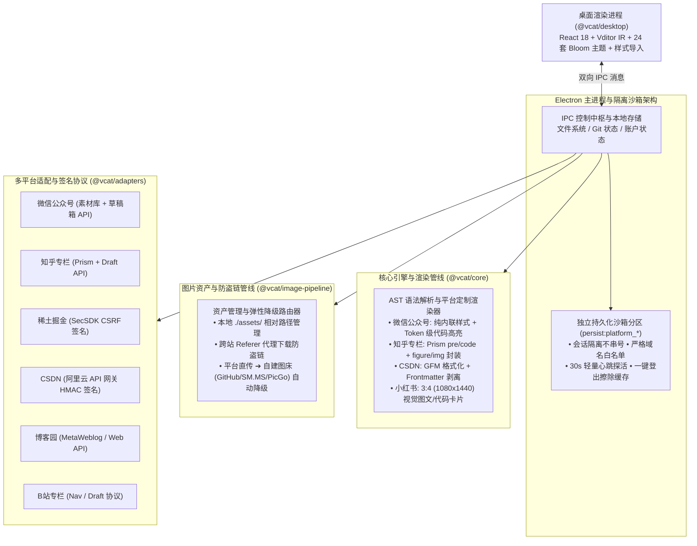

<div align="center">

# Vmark（维记）

### Local-First（本地优先）Markdown 创作与多平台合规分发桌面工作台

**`V`（Verified · 翼标）+ `Mark`（Markdown · 书签印记）：一个纯粹、离线优先、支持 24 套 Bloom 主题与自定义 CSS 的桌面端 Markdown 编辑器，打通本地写作、图片资产管理与多平台（微信公众号、知乎、稀土掘金、CSDN、小红书、博客园等）合规分发。**

[](LICENSE)
[](#-系统架构设计)
[](#-项目结构monorepo)
[](#-快速启动)
[](#-支持平台与分发策略)

[系统架构设计](#-系统架构设计) · [快速启动](#-快速启动) · [核心特性亮点](#-核心特性亮点) · [多平台分发策略](#-支持平台与分发策略) · [项目结构](#-项目结构monorepo) · [常见问题 FAQ](#-常见问题-faq)

</div>

---

## 🎯 什么是 Vmark（维记）？

**Vmark（维记）** 是一款专为技术博主、独立开发者与内容创作者打造的 **Local-First（本地优先）桌面端 Markdown 写作与多平台分发工作台**（macOS / Windows）。

在当今的内容创作工作流中，创作者常面临：
- **云端服务绑定与数据安全风险**：编辑器闭源或云端依赖，遇到平台改版或网络抖动易造成排版错乱甚至丢稿；
- **平台格式墙与排版碎片化**：微信公众号封杀外部样式、知乎仅支持特定 Prism 类名与 `<figure>` 图片结构、CSDN 与掘金各有特定的 Markdown Frontmatter 与 CSRF 防护；
- **图片防盗链与图床折磨**：不同平台有各自的图片白名单，频繁遭遇跨站 Referer 防盗链与外链失效。

Vmark 通过**本地目录即工作区**的理念，将整套“写作 - 渲染编译 - 防盗链转存 - 多沙箱隔离分发”收拢进轻量高效的本地桌面端。

---

## 🏗️ 系统架构设计

Vmark 采用 **`pnpm workspace + Turborepo`** 现代化 Monorepo 架构进行分层解耦，各子包职责明确、单向依赖：



---

## ✨ 核心特性亮点

### 1. 100% Local-First（本地优先存储，零云端锁定）
* **目录即工作区**：打开任意本地文件夹即可开始写作，所有文章直接保存为干净的标准 `.md`；
* **图片就近落盘**：粘贴或插入图片自动以哈希命名存入当前工作区下的 `./assets/`，断网 100% 完整浏览编辑，随时可通过 Git 一键版本管理。

### 2. 独立沙箱隔离与严格票据鉴权治理
* **多账号隔离沙箱**：每个外部平台运行在独立的 Electron `persist:platform_<id>` 沙箱分区中，彻底解决多平台账号 Cookie 串号与污染问题；
* **严格域名白名单与接口签名**：
  * **微信公众号**：必须持有 `slave_user` 与 `slave_sid` 双票据并通过后台探活验证；
  * **CSDN**：内置阿里云 API 网关 HMAC-SHA256 请求签名（`x-ca-key`, `x-ca-nonce`, `x-ca-signature`）；
  * **稀土掘金**：自动获取 ByteDance SecSDK 的 `x-ware-csrf-token` 与 `x-secsdk-csrf-token` 签名；
  * **知乎 / 百家号 / 博客园**：严格比对主域名归属，防止第三方子域杂质 Cookie 引起假授权。
* **轻量探活与一键清理**：30 秒后台轻量级状态检测，原子写入 `platform_accounts.json`；提供「退出授权」一键彻底清除分区 Cookie、LocalStorage 与 HTTP 认证缓存。

### 3. 平台原生级 AST 编译渲染管线
* **微信公众号**：
  * 微信编辑器严禁外部 `<style>` 和类名，Vmark 实现了**行内 Token 级语法着色引擎**，关键字深红加粗、字符串墨蓝、注释斜体灰；
  * 顶部封装经典 Mac 红黄绿三圆点顶栏，外链自动解析提取并优雅转换为文末数字脚注。
* **知乎专栏**：
  * 自动将 H1 降级为 H2 以契合专栏目录；代码块生成标准 `<pre><code class="language-*">` 契合专栏 Prism.js；图片自动转换为带有排版样式的 `<figure>` 结构。
* **小红书**：
  * 自动将技术长文提炼转化为 **3:4 比例（1080×1440）视觉卡片**（包括高对比封面卡片、正文卡片与深色磨砂代码卡片），并生成带有话题标签矩阵的精炼笔记。

### 4. 弹性图床架构与防盗链代理
* **三级弹性降级机制**：发布时优先调用平台原生素材直传；遇到平台接口不可用或受限时，自动无缝降级使用用户配置的统一图床（GitHub / SM.MS / PicGo-Core）；
* **跨站防盗链中转**：外部引用图片（如微信 mmbiz 或第三方 CDN）在发布时由 Node 进程自动携带源站 `Referer` 抓取后安全转存。

---

## 📸 界面实拍预览

| 白色沉浸写作与大纲/文件树 | 暗黑 Bloom 主题与流程图/代码高亮 | 本地文章管理台与统计视图 |
| :---: | :---: | :---: |
|  |  |  |

---

## 🌐 支持平台与分发策略

Vmark 坚持务实、合规的分发原则，**优先推入各平台草稿箱**，由创作者进行最终审核与确认：

| 分发策略 | 覆盖平台 | 实际落地机制 |
| :--- | :--- | :--- |
| **推入草稿箱（人工二次确认）** | **微信公众号**、**知乎专栏**、**稀土掘金**、**CSDN**、**百家号**、**B 站专栏**、**小红书** | 自动转存图片并编译排版，调用官方草稿接口推入用户账号草稿箱，用户可在平台确认后发布，保障账号安全 |
| **直接发布 / 选板块直发** | **Linux.do (Discourse)**、**博客园 (MetaWeblog)**、**GitHub 静态博客** | 接口稳定、无需二次审核场景，直接发布并回查直达链接 |
| **卡片视觉导出** | **小红书**、**朋友圈 / 微博图文** | 一键批量生成 3:4 比例高保真长图与代码卡片 |

---

## 🚀 快速启动

### 环境要求
- Node.js >= 18.0.0
- pnpm >= 9.0.0

### 本地开发

```bash
# 1. 克隆代码仓库
git clone https://github.com/vcat-team/vmark.git
cd vmark

# 2. 安装全部依赖
pnpm install

# 3. 启动开发模式（Electron + Vite 热更新）
pnpm dev
```

### 运行测试与类型检查

```bash
# 运行全部单测（44 个用例全部覆盖）
pnpm test

# 全局 TypeScript 严格类型检查
pnpm typecheck

# 生产环境打包构建
pnpm build
```

---

## 📂 项目结构（Monorepo）

```text
vmark/
├── apps/
│   └── desktop/                  # Electron + Vite + React 18 桌面端壳工程
│       ├── src/main/             # 主进程：窗口管理、IPC 路由、沙箱会话、心跳引擎
│       ├── src/preload/          # Preload 桥接层与 contextBridge 安全暴露
│       └── src/renderer/         # 渲染进程：Vditor 编辑器、主题系统、发布弹窗
├── packages/
│   ├── shared/                   # 全局 TypeScript 契约、偏好设置与平台模型定义
│   ├── core/                     # 本地目录扫描、大纲解析、表格矩阵、多平台渲染引擎
│   ├── image-pipeline/           # 图片资产解析、本地管理、防盗链代理与自建图床
│   └── adapters/                 # 微信/知乎/掘金/CSDN/博客园等平台发布适配器与协议
├── docs/                         # 架构设计方案、发稿规约与交接文档
└── openspec/                     # 规格驱动开发提案与变更记录
```

---

## ❓ 常见问题 FAQ

- **Q：Vmark 和传统在线博客后台或多发工具有什么区别？**  
  A：Vmark 是 100% 本地优先（Local-First）的桌面端。你的文章与图片完全保存在本地磁盘，断网可用，不会有云端丢稿风险；多平台发布通过本地 Electron 隔离沙箱直接向各平台接口推送，不需要将平台 Cookie 或密钥上传到任何第三方中转服务器，隐私安全有保障。
- **Q：如何添加或更换自己的外观主题？**  
  A：内置 24 套精心调色的 Bloom 明暗主题。也可以在「偏好设置（`Cmd+,`）→ 外观主题」中一键导入任意自定义 CSS 样式文件。
- **Q：为什么很多平台默认选择推入草稿箱而不是一键发布？**  
  A：主流自媒体平台（如微信、知乎、掘金、小红书等）对自动化批量直接发布有严格的流控与风控机制。推入草稿箱不仅合规安全，还能让创作者在手机或网页端做最后一次封面、话题及字句微调，兼顾效率与掌控感。

---

## 📄 开源与商业双授权协议（AGPL-3.0 / Commercial Dual License）

本项目采用 **GNU AGPL-3.0-only + 商业付费双授权模式**：

- **开源使用**：个人学习、科研及遵守 AGPL-3.0 条款完整开源衍生源码的项目（含服务端网络交互场景），可按 [LICENSE](LICENSE)（GNU AGPL-3.0-only）免费使用与分发。
- **商业使用**：任何闭源集成、私有商业发行版或闭源商用 SaaS 服务，均须联系版权方购买商业授权。详情与外部 PR 贡献条款（CLA/DCO）请查阅 [LICENSE-COMMERCIAL.md](LICENSE-COMMERCIAL.md)。
