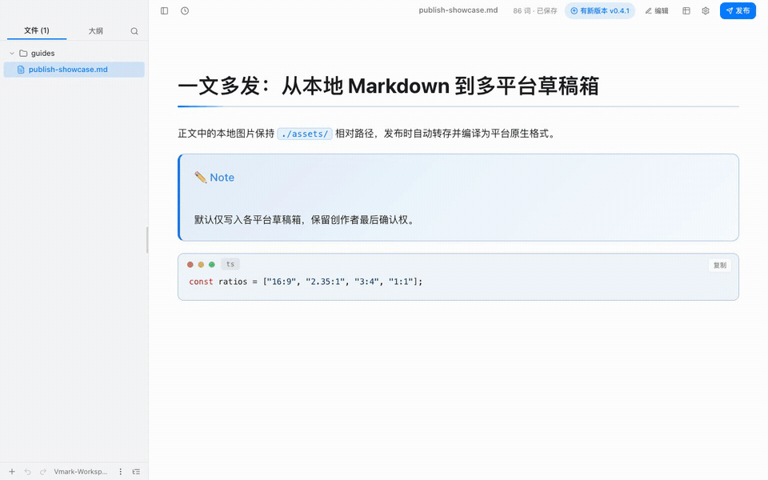
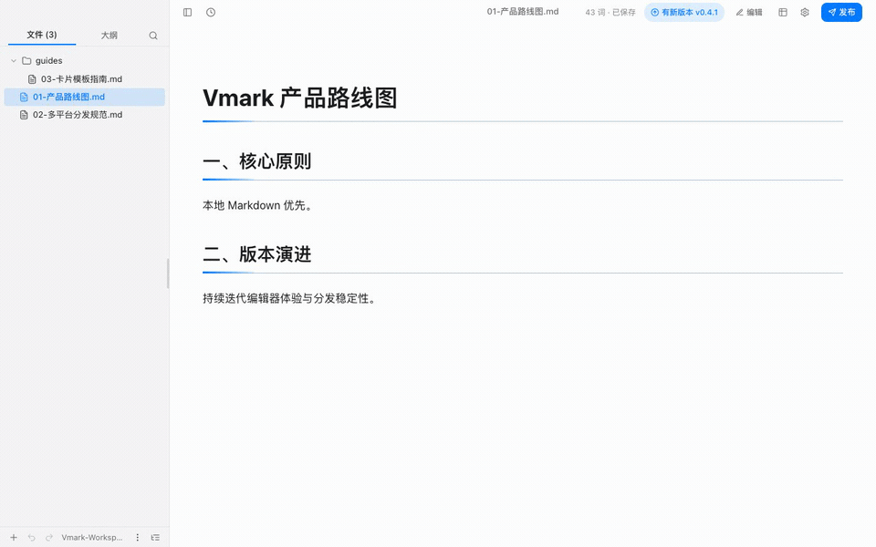
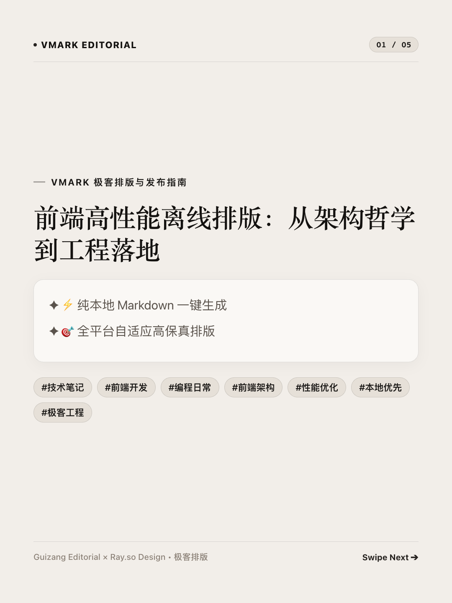
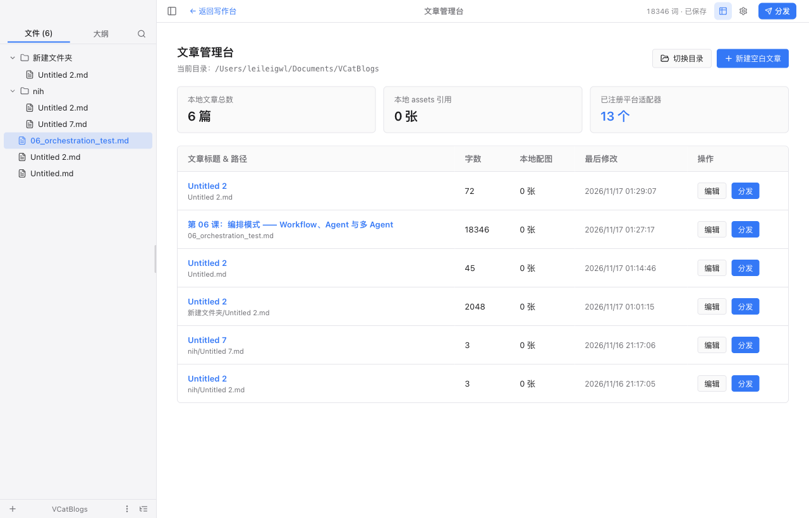

<div align="center">


# Vmark（维记）

**简体中文** | [English](README_EN.md)

### 写好一篇文档，一键分发到全平台——自带防盗链转图与小红书/抖音 3:4 视觉卡片

**一款专为知识整理、技术总结与办公写作打造的桌面端文档编辑器（像 Obsidian 一样专注写文档）。写完不用截图、不用手工传图、不用逐个切后台调排版：**
**Vmark 自动解决各平台图片防盗链裂图，把文章直接转为平台适配正文与小红书 / 抖音专属 3:4 视觉图文卡片，一并安全推入各平台草稿箱，最后由你点一下即可发布。**

[](LICENSE)
[%20%7C%20Windows%20%C2%B7%20Linux%20(%E5%AE%9E%E9%AA%8C%E6%80%A7)-3b7cc4.svg)](https://github.com/leileigwl/vmark/releases/latest)
[](#-系统架构与-monorepo-目录)

[官方网站](https://vmark-6cc.pages.dev) · [下载最新版](https://github.com/leileigwl/vmark/releases/latest) · [功能演示](#-功能演示) · [一键多平台分发](#-核心王牌一次写作一键分发多平台) · [桌面写作体验](#-同样顺手的桌面文档写作与管理体验) · [常见问题](#-常见问题-faq)

<br />

| 浅色沉浸写作台（Apple Light · 文件树 + 大纲 + Callout） | 暗黑护眼模式（Bloom Dark · 代码高亮 + Mermaid 流程图） |
| :---: | :---: |
|  |  |

</div>

---

## 🎬 功能演示

| 即时渲染与主题切换（IR · 表格 Tab 跳格 · Bloom 24 套主题） | 多比例配图与多平台草稿箱（16:9 · 2.35:1 · 3:4 卡片） |
| :---: | :---: |
|  |  |

<div align="center">

| 工作区管理台 · 快速打开（`⇧⌘O`）· 账号状态与版本更新 |
| :---: |
|  |

</div>

---

## 🚀 核心王牌：一次写作，一键分发多平台

写技术文档、产品记录或周报时，最劝退的往往不是写正文，而是写完后还要手工传图、解决防盗链裂图、切到十几个创作者后台重新排版。Vmark 把整套繁琐工序压缩成一次点击：

1. **自动防盗链转图，不改写原始文档**
   - 推送前自动把文档里的本地配图与外部防盗链图片，在**内存层面逐一上传并转存为目标平台自己的图片链接**（或自建图床），彻底告别粘贴后「图片已失效 / 盗链不可见」；整个过程**绝不篡改你的原始 `.md` 文档**，后续还会持续扩展更多平台支持。
2. **小红书 & 抖音图文内置浏览器深度优化：自动切 3:4 视觉卡片，点一下就能发**
   - 直接往小红书或抖音硬传文档截图往往不够美观。Vmark 内置针对**小红书与抖音图文**深度适配的自动化流程，按内容流畅分页渲染成 **1080×1440（3:4）高清视觉图文卡片**（不再额外生成多余标题封面卡），并在内置浏览器中帮你自动上传全部卡片、填入标题、整理好分段纯文本与 `#话题`，**直接存进草稿箱**——你只需要打开草稿看一眼，点一下就能发出。
   - **开源致谢**：3:4 卡片手账版式与视觉风格参考了社区优秀开源卡片项目并做了深度集成与排版打磨，特此致谢。
3. **「一键全选可推送」：通用信息填一次，平台差异分开管**
   - 自动检测 10 平台登录状态与必填项，支持**一键全选可推送**——缺封面的平台（如公众号）或未选分类的平台（如稀土掘金）会清晰高亮提示补充项，未就绪平台不会卡住其他已就绪平台；
   - **标题、摘要、标签等通用信息只需填写一次即可全部共用**；而**公众号单独封面、掘金文章分类、小红书与抖音卡片模板**各自独立配置、互不串扰；既支持全选一键发草稿，也支持只挑单个平台单独分发。
4. **本地隔离登录、实时跟随主题 & 默认只推草稿箱**
   - 每个平台账号各自保存在本地独立隔离分区，凭据由系统安全加密保管，无第三方中转服务器；内置独立登录窗口配备简洁顶栏（实时跟随软件浅色/深色模式变色），完成登录后自动刷新识别状态；所有内容平台**默认仅推入草稿箱**，保留创作者最后把关权。

<div align="center">

| 极简手记封面卡 (3:4) | Ink Classic 杂志封面 | 深色磨砂代码卡片 |
| :---: | :---: | :---: |
|  |  |  |

</div>

### 支持平台矩阵（持续扩展中）

| 分发模式 | 覆盖平台 | 核心能力 |
| :--- | :--- | :--- |
| **推入草稿箱（推荐）** | **微信公众号**、**知乎专栏**、**稀土掘金**、**CSDN**、**博客园**、**百家号**、**微博**、**B 站专栏**、**小红书**、**抖音** | 自动防盗链转图 + 平台定制格式编译（如微信内联代码高亮与文末脚注）+ 自动存草稿并校验 |
| **静态博客直推** | **GitHub 静态博客**（Hexo / Hugo / VitePress / Astro） | 一键 Git Push 触发构建工作流 |
| **3:4 视觉卡片导出** | **小红书**、**抖音**、**朋友圈长图** | 离线高保真导出多套手账 / 杂志 / 代码视觉卡片 |

---

## ✍️ 同样顺手的桌面文档写作与管理体验

即使不立即发平台，Vmark 也是一套日常顺手、轻量优雅的桌面办公与文档工作台：

- **📖 编辑 / 只读双模式 + 看图放大缩小**：右上角随时在**编辑模式**与**只读阅读模式**间切换；只读模式下点击文内任意图片即可进入看图弹窗，支持**放大、缩小与一键复位**细节。
- **⌨️ 顺滑键盘细节**：支持 **`/` 斜杠命令菜单**快速插入块元素、**`Tab` / `Shift+Tab` 表格跳格与列表缩进**、跨块与分割线流畅选区删除，以及代码块行内上下文快捷键。
- **📐 结构化文档原生渲染**：开箱支持 **Mermaid 流程图 / 时序图**、**KaTeX 数学公式**、标准 GFM 表格、语法高亮代码块与 `[!NOTE]` / `[!TIP]` Callout 提示块；支持 **16:9 / 2.35:1 / 1:1 / 3:4** 多比例配图焦点裁剪。
- **🎨 24 套 Bloom 浅/深色主题 + 自定义 CSS（致谢社区）**：集成 24 套浅色与暗黑护眼配色，并支持一键导入自定义 `.css` 样式；外观体系参考了社区优秀设计灵感并由团队深度整合优化。
- **🗂️ 轻巧好用的目录与文件管理**：支持随时切换本地工作区目录、新建空白文章、**批量删除过期文档**、右侧/左侧**大纲点击直达跳转**、文件树高亮定位与在**系统文件管理器中显示**；同时支持文章管理台盘点全文与**把平台已发旧文章反向拉取为普通 `.md` 文档**（文件直接保存在本地文件夹，不锁任何专有云端库）。

<div align="center">



</div>

---

## 📦 下载安装与本地开发

### 终端用户下载

前往 [GitHub Releases](https://github.com/leileigwl/vmark/releases/latest) 下载安装包。**当前版本以 macOS 作为主力推荐平台**（已完成编辑器与 10 平台草稿箱全链路真机实测），Windows 与 Linux 安装包由 CI 自动产出作为实验性构建供体验，后续迭代将继续重点适配：

| 操作系统 | 支持状态 | 安装包格式 | 说明 |
| :--- | :--- | :--- | :--- |
| **macOS** (Apple Silicon / Intel) | **主力推荐（已真机全链路验证）** | `.dmg` / `.zip` | 拖入 `Applications`；首次启动如遇未签名提示，请在「系统设置 → 隐私与安全性」点击仍要打开 |
| **Windows** (x64) | 实验性构建（持续完善中） | `.exe` | 凭据通过系统 DPAPI (`safeStorage`) 加密；后续版本持续跟进快捷键与多平台兼容性 |
| **Linux** (Ubuntu / Debian) | 实验性构建（持续完善中） | `.AppImage` / `.deb` | 赋予执行权限直接运行或 `dpkg -i` 安装；后续迭代重点完善桌面集成 |

### 后续开发计划（Roadmap）

- 重点推进 **Windows / Linux 跨平台真机适配与体验统一**；
- 持续扩充**更多内容分发平台与自定义图床**能力，进一步完善文件导入、导出与边缘格式兼容；
- 跟进各平台创作后台改版，保持登录检测与草稿箱投递稳定可用。

### 开发者本地运行

环境要求：**Node.js >= 20.0.0**、**pnpm >= 9.0.0**（全仓仅使用 `pnpm`）。

```bash
# 1. 克隆仓库并安装依赖
git clone https://github.com/leileigwl/vmark.git
cd vmark
pnpm install

# 2. 启动桌面端开发模式（Electron + Vite 热更新）
pnpm dev

# 3. 类型检查、测试与构建
pnpm typecheck
pnpm test
pnpm build
```

> **官网展示页 (`website/`)**：仓库内同时包含基于 Vite + React + Tailwind CSS 构建的中英双语产品展示官网，支持部署至 Cloudflare Pages 并自动联动 `sitemap.xml` / `robots.txt` / `llms.txt`。详见 [website/DEPLOY.md](website/DEPLOY.md)。

---

## 🏗️ 系统架构与 Monorepo 目录

项目采用 `pnpm workspace + Turborepo` 分层组织，详见 [产品定位文档](docs/PRODUCT.md) 与 [技术架构规范](docs/ARCHITECTURE.md)。

<details>
<summary>点击展开查看 Monorepo 目录与核心架构</summary>

```text
vmark/
├── apps/
│   └── desktop/                  # Electron + Vite + React 18 桌面端应用
│       ├── src/main/             # 主进程：文件系统、IPC 路由、隔离沙箱分区、自动更新
│       ├── src/preload/          # Preload 安全桥接层
│       └── src/renderer/         # 渲染进程：Vditor IR 编辑器、Bloom 主题、文章管理、分发流
├── packages/
│   ├── shared/                   # 共享 TypeScript 契约与平台规范模型
│   ├── core/                     # 目录扫描、大纲解析、平台 AST 渲染与 3:4 卡片引擎
│   ├── image-pipeline/           # 本地 ./assets/ 管理、防盗链转存与弹性图床降级
│   └── adapters/                 # 多平台认证检测与草稿分发适配器
├── website/                      # 官方产品展示页（支持 SEO / GEO / Cloudflare Pages）
├── docs/                         # 产品规格、UI 规范与设计文档
└── openspec/                     # 规格驱动开发文档
```

</details>

---

## ❓ 常见问题 FAQ

- **Q：图片防盗链转存怎么工作？会不会把我的本地文档改乱？**  
  A：完全不会。点击推送时，Vmark 只会在内存中读取你文章里的本地图片（`./assets/`）和外部防盗链图片链接，上传至各平台自己的素材库后再把图床地址填进草稿内容；你本地磁盘上的 `.md` 原文件始终保持原样、只字不改。
- **Q：一键分发会不会一不小心直接发成公开文章？我的账号 Cookie 安全吗？**  
  A：主流 10 个内容平台全部默认只写入对应账号的**草稿箱**，由你在后台预览确认后再自行发布；每个平台都在本地独立持久化分区中运行，敏感凭据由操作系统级加密（如 macOS Keychain / Windows DPAPI）本地保管，不经任何第三方服务器中转。
- **Q：小红书和抖音没有文章接口怎么发？目前推荐什么系统？**  
  A：Vmark 先将文章渲染成 **1080×1440（3:4）高清视觉卡片**并提取分段纯文本与 `#话题`，再通过内置隔离浏览器自动填入小红书与抖音的图文草稿箱，你在草稿里确认后点一下即可发布。当前 **macOS（Apple Silicon / Intel）** 已完成全部编辑器与 10 平台草稿箱真机实测，Windows / Linux 暂以实验性构建提供。

---

## 📄 开源与商业双授权协议

本项目采用 **GNU AGPL-3.0-only + 商业授权双协议**：

- **开源使用**：个人学习、科研及完整遵守 AGPL-3.0 条款的开源项目，可按 [LICENSE](LICENSE) 免费使用与分发。
- **商业使用**：闭源集成、私有商业发行版或闭源商用服务，须购买商业授权。详情请查阅 [LICENSE-COMMERCIAL.md](LICENSE-COMMERCIAL.md)。
