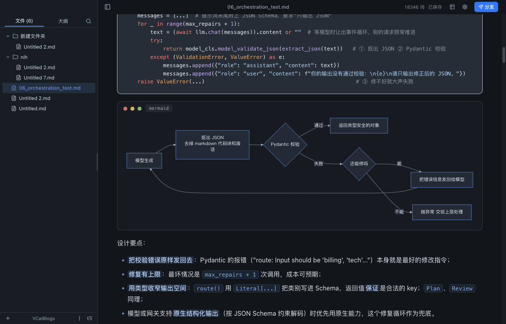
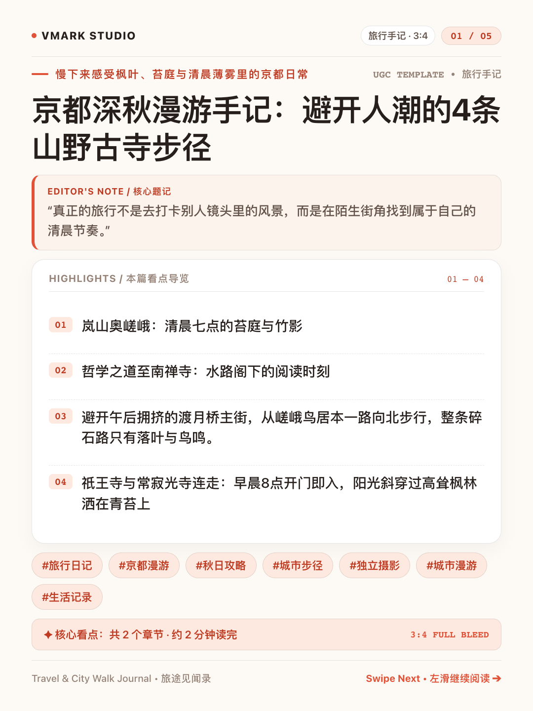
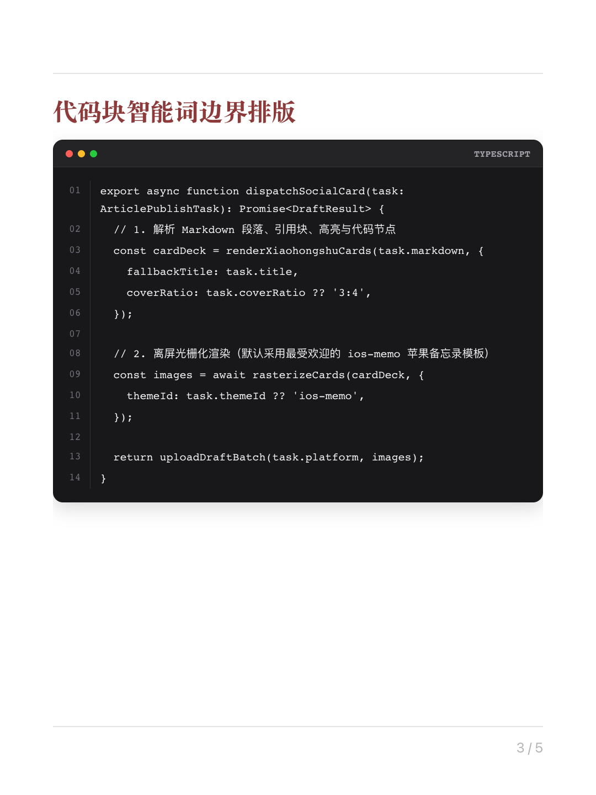

<div align="center">


# Vmark（维记）

**简体中文** | [English](README_EN.md)

### 安静写好每一篇本地 Markdown 笔记，写完顺手分发到全平台

**`V`（Verified · 翼标）+ `Mark`（Markdown · 书签印记）：一款 100% Local-First（本地优先）的桌面端 Markdown 笔记与文档编辑器。打开任意本地文件夹即可专注记录，支持即时渲染、大纲检索、Mermaid 流程图、KaTeX 公式与 24 套 Bloom 主题；写完无需复制粘贴，内置防盗链图片转存与平台草稿箱合规分发。**

[](LICENSE)
[%20%7C%20Windows%20%C2%B7%20Linux%20(%E5%AE%9E%E9%AA%8C%E6%80%A7)-3b7cc4.svg)](https://github.com/leileigwl/vmark/releases/latest)
[](#-为什么选择-vmark-做笔记)
[](#-系统架构与-monorepo-目录)

[官方网站](https://vmark-6cc.pages.dev) · [下载最新版](https://github.com/leileigwl/vmark/releases/latest) · [功能演示](#-功能演示) · [核心笔记体验](#-为什么选择-vmark-做笔记) · [多平台分发与卡片](#-写完之后一键分发到-10-平台) · [常见问题](#-常见问题-faq)

<br />

| 浅色沉浸笔记写作台（Apple Light · 文件树 + 大纲 + Callout） | 暗黑护眼模式（Bloom Dark · 代码高亮 + Mermaid 流程图） |
| :---: | :---: |
|  |  |

</div>

---

## 🎬 功能演示

| 即时渲染与主题切换（IR · 表格 Tab 跳格 · Bloom 24 套主题） | 多比例配图与多平台草稿箱（16:9 · 2.35:1 · 3:4 卡片） |
| :---: | :---: |
|  |  |

<div align="center">

| 工作区管理台 · 快速打开（`⇧⌘O`）· 账号状态与版本更新 |
| :---: |
|  |

</div>

---

## ✨ 为什么选择 Vmark 做笔记？

Vmark 首先是一座**纯粹、离线可用、数据完全属于你的本地 Markdown 笔记与文档工作台**——即使你完全不发布文章，它依然是一款顺手的日常记录与技术写作工具：

- **📂 目录即工作区（100% Local-First）**：无需注册软件账号，没有专有数据库锁定。打开或随时切换任意本地文件夹即可写作，支持快速新增空白文章、批量清理文件，并在文件树与系统文件管理器（Finder 等）中一键定位；粘贴或拖入图片自动按哈希保存至 `./assets/` 并写入相对路径，断网 100% 完整读写，天然兼容 Git 与云同步盘。
- **✍️ 即时渲染（IR）+ 只读预览与细节打磨**：支持**编辑模式与只读阅读模式**随时切换——只读阅读时点击正文图片可**放大、缩小、复位**查看细节；写作时支持 **`/` 斜杠命令菜单**快速插块、**`Tab` / `Shift+Tab` 表格跳格与列表缩进**、跨分割线流畅删除；左侧整合可折叠**文件树、实时点击大纲跳转与全文搜索**，顶栏集成词数统计与版本更新提醒。
- **📐 技术文档与知识梳理利器**：原生支持 **Mermaid 流程图 / 时序图**、**KaTeX 数学公式**、标准 GFM 表格、代码块语法高亮以及 `[!NOTE]` / `[!TIP]` 等 Callout 提示块。
- **🎨 24 套 Bloom 浅色/暗黑主题 + 自定义 CSS**：默认提供 24 套精心打磨的浅色与深色护眼主题（参考社区优秀编辑器与卡片视觉设计并深度集成），支持一键导入自定义 `.css` 样式；内置登录窗口顶栏也会实时跟随应用浅色/深色主题变色。
- **🗂️ 本地文章管理台 & 平台草稿回流**：内置文章管理视图，一眼清点工作区内的笔记字数、本地配图与修改时间；还支持把散落在各平台后台的旧文章**反向拉取回本地**，自动转为 `.md` 并下载图片至 `./assets/`，导入后彻底切断云端绑定。

<div align="center">


</div>

---

## 🚀 写完之后：一键分发到 10+ 平台

记完笔记、写好技术总结想公开发表时，Vmark 帮你跳过“手工传图 → 切多个后台 → 重调格式”的繁琐工序：

1. **全选可推送、一次填通用项、按平台分项微调**：
   - 自动检测 10 平台登录态与必填信息，支持「**一键全选可推送**」——缺分类或少封面的平台会明确提示补充项，不会卡住已经就绪的平台；
   - **标题、摘要、标签等通用信息填一次即可全平台复用**；而**公众号单独封面、稀土掘金文章分类、小红书与抖音 3:4 卡片排版**等平台专属设置则各自独立保存、互不串扰；既可 10 平台一并推草稿箱，也可单平台单独分发。
2. **平台原生级 AST 编译与防盗链图片转存**：
   - **微信公众号 / 百家号 / 微博 / B 站 / 知乎**：针对各平台规范转换内联代码着色、外链文末脚注、标题层级或 `<figure>` 结构；**稀土掘金 / CSDN / 博客园**适配干净 GFM Markdown 与分类要求。
   - **内存级图片转存与多比例裁剪**：支持 **16:9 通用封面 + 2.35:1 公众号头条 + 1:1 小图 + 3:4 卡片**焦点裁剪；推送时自动将 `./assets/` 与外部图片上传至对应平台素材库或自建图床，**绝不篡改本地 `.md` 源文件**。
3. **本地沙箱隔离、统一登录窗与默认只推草稿箱**：
   - 每个平台运行在本地持久化隔离分区，凭据由系统加密保护，零第三方中转服务器；内置独立登录窗提供标准导航与主题跟随，完成登录后关闭窗口或跳转后台页面即可自动刷新识别状态；全平台**默认仅推入草稿箱**，由你在各平台后台最终确认后再发布。
4. **3:4 高清视觉卡片引擎（致谢社区灵感）**：
   - 专门面向小红书、抖音将长文直接按内容分页渲染为 **1080×1440** 视觉卡片（极简杂志、备忘录、便利贴、代码卡片等风格），不再额外塞入多余标题封面卡。视觉卡片手账版式设计参考了社区优秀开源卡片项目并做了本地离线集成与分页细节打磨，在此一并致谢。

<div align="center">

| 极简手记封面卡 (3:4) | Ink Classic 杂志封面 | 深色磨砂代码卡片 |
| :---: | :---: | :---: |
|  |  |  |

</div>

### 支持平台矩阵

| 分发模式 | 覆盖平台 | 核心机制 |
| :--- | :--- | :--- |
| **推入草稿箱（推荐）** | **微信公众号**、**知乎专栏**、**稀土掘金**、**CSDN**、**博客园**、**百家号**、**微博**、**B 站专栏**、**小红书**、**抖音** | 自动转存图片 + 平台定制排版，安全写入各平台账号草稿箱并返回核对结果 |
| **静态博客直推** | **GitHub 静态博客**（Hexo / Hugo / VitePress / Astro） | 一键 Git Push 触发工作流更新静态站点 |
| **3:4 视觉卡片导出** | **小红书**、**抖音**、**朋友圈长图** | 离线高保真光栅化为多套手账 / 杂志 / 代码视觉卡片 |

---

## 📦 下载安装与本地开发

### 终端用户下载

前往 [GitHub Releases](https://github.com/leileigwl/vmark/releases/latest) 下载对应系统的安装包。**当前版本以 macOS 作为主力推荐平台**（已完成编辑器与 10 平台草稿箱全链路真机实测），Windows 与 Linux 安装包由 CI 自动产出，作为实验性构建供尝鲜，后续将重点持续完善：

| 操作系统 | 支持状态 | 安装包格式 | 说明 |
| :--- | :--- | :--- | :--- |
| **macOS** (Apple Silicon / Intel) | **主力推荐（已真机全链路验证）** | `.dmg` / `.zip` | 拖入 `Applications`；首次启动如遇未签名提示，请在「系统设置 → 隐私与安全性」点击仍要打开 |
| **Windows** (x64) | 实验性构建（持续完善中） | `.exe` | 凭据通过系统 DPAPI (`safeStorage`) 加密；如遇快捷键、排版或分发兼容性问题欢迎反馈 |
| **Linux** (Ubuntu / Debian) | 实验性构建（持续完善中） | `.AppImage` / `.deb` | 赋予执行权限直接运行或 `dpkg -i` 安装；后续迭代重点补齐桌面集成 |

### 后续开发计划（Roadmap）

- 重点推进 **Windows / Linux 跨平台真机适配与细节打磨**；
- 扩充**自定义图床与图片托管支持**，完善文件导入、导出能力并修复边缘导出问题；
- 持续跟进各内容平台后台改版（如登录鉴权与草稿接口稳定性维护）。

### 开发者本地运行

环境要求：**Node.js >= 20.0.0**、**pnpm >= 9.0.0**（全仓仅使用 `pnpm`）。

```bash
# 1. 克隆仓库并安装依赖
git clone https://github.com/leileigwl/vmark.git
cd vmark
pnpm install

# 2. 启动桌面端开发模式（Electron + Vite 热更新）
pnpm dev

# 3. 校验与构建
pnpm typecheck
pnpm test
pnpm build
```

> **官网展示页 (`website/`)**：仓库内同时包含基于 Vite + React + Tailwind CSS 构建的中英双语产品展示官网，支持部署至 Cloudflare Pages 并自动联动 `sitemap.xml` / `robots.txt` / `llms.txt`。详见 [website/DEPLOY.md](website/DEPLOY.md)。

---

## 🏗️ 系统架构与 Monorepo 目录

项目采用 `pnpm workspace + Turborepo` 分层组织，详见 [产品定位文档](docs/PRODUCT.md) 与 [技术架构规范](docs/ARCHITECTURE.md)。

<details>
<summary>点击展开查看 Monorepo 目录与核心架构</summary>

```text
vmark/
├── apps/
│   └── desktop/                  # Electron + Vite + React 18 桌面端应用
│       ├── src/main/             # 主进程：文件系统、IPC 路由、隔离沙箱分区、心跳探活
│       ├── src/preload/          # Preload 安全桥接层
│       └── src/renderer/         # 渲染进程：Vditor IR 编辑器、Bloom 主题、文章管理、分发流
├── packages/
│   ├── shared/                   # 共享 TypeScript 契约与平台规范模型
│   ├── core/                     # 目录扫描、大纲解析、平台 AST 渲染与 3:4 卡片引擎
│   ├── image-pipeline/           # 本地 ./assets/ 管理、防盗链代理与弹性图床降级
│   └── adapters/                 # 多平台认证检测与草稿分发适配器
├── website/                      # 官方产品展示页（支持 SEO / GEO / Cloudflare Pages）
├── docs/                         # 产品规格、UI 规范与设计文档
└── openspec/                     # 规格驱动开发文档
```

</details>

---

## ❓ 常见问题 FAQ

- **Q：我不做自媒体，平时只用来写本地 Markdown 笔记和文档，适合用 Vmark 吗？**  
  A：非常适合。Vmark 的第一定位就是纯净的 Local-First 桌面 Markdown 笔记工作台，文件树、大纲、全文搜索、即时渲染、Mermaid、KaTeX 与 24 套 Bloom 主题均离线可用，完全无需绑定任何发布账号。
- **Q：为什么 Vmark 不做自己的云端账号和双向同步？**  
  A：为了彻底避免云端绑定和覆盖冲突。你的笔记就是普通 `.md` 文件与 `./assets/` 图片文件夹，可以自由配合 Git、iCloud Drive、OneDrive 或 Syncthing 完成备份与多设备同步。
- **Q：多平台分发时，我的 Cookie 和图床密钥会上传到服务器吗？**  
  A：不会。Vmark 是纯本地桌面端应用，没有第三方后端中转服务器；每个平台在本地独立沙箱分区运行，敏感凭据由系统级安全存储保护。

---

## 📄 开源与商业双授权协议

本项目采用 **GNU AGPL-3.0-only + 商业授权双协议**：

- **开源使用**：个人学习、科研及完整遵守 AGPL-3.0 条款的开源项目，可按 [LICENSE](LICENSE) 免费使用与分发。
- **商业使用**：闭源集成、私有商业发行版或闭源商用服务，须购买商业授权。详情请查阅 [LICENSE-COMMERCIAL.md](LICENSE-COMMERCIAL.md)。
