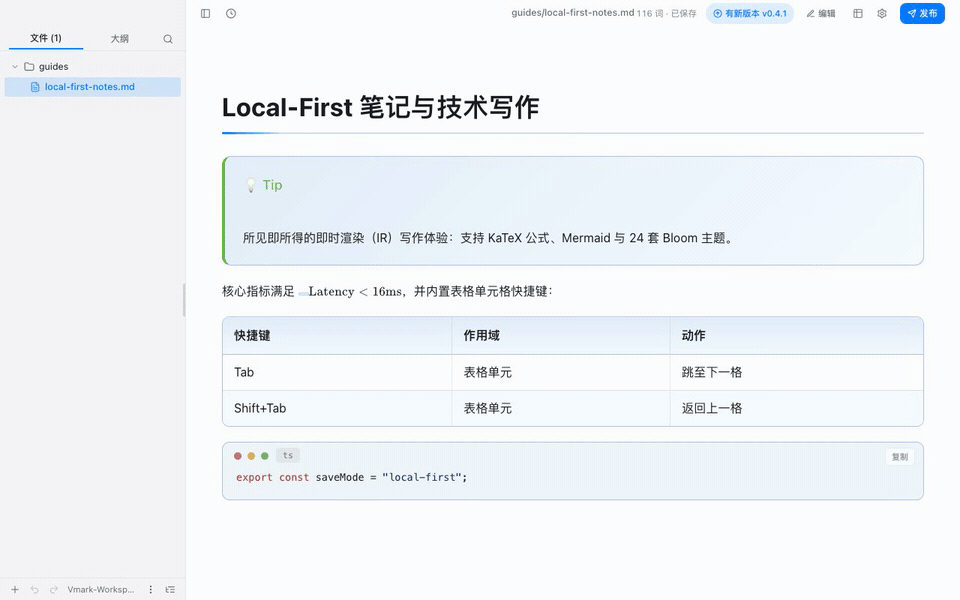

<div align="center">


# Vmark（维记）

**简体中文** | [English](README_EN.md)

### 写好一篇文档，顺手分发到全平台——再也不用逐个后台传图排版

**如果你平时习惯写 Markdown 文档或技术笔记，发文章时最烦的往往不是写字，而是贴到各个平台后图片全裂、格式全乱，发小红书和抖音还得另外做图。**
**所以我做了并开源了 Vmark：平时安安静静写文档，写完点一下，图片自动传好、格式自动配好，直接帮你存进十个平台的草稿箱——包括自动把长文切成小红书和抖音 3:4 视觉卡片，最后点一下就能发。**

[](LICENSE)
[%20%7C%20Windows%20%C2%B7%20Linux%20(%E5%AE%9E%E9%AA%8C%E6%80%A7)-3b7cc4.svg)](https://github.com/leileigwl/vmark/releases/latest)

[官方网站](https://vmark.leileigwl.cn) · [下载最新版](https://github.com/leileigwl/vmark/releases/latest) · [功能演示](#-功能演示) · [一键多平台草稿箱](#-为什么大家用-vmark-发文章更省心) · [日常写作体验](#-不发布时它也是一本顺手的桌面文档本) · [常见问题](#-常见问题-faq)

<br />

| 浅色沉浸写作台（Apple Light · 文件树 + 大纲 + 提示块） | 暗黑护眼模式（Bloom Dark · 代码高亮 + 流程图） |
| :---: | :---: |
|  |  |

</div>

---

## 🎬 功能演示

| 即时渲染与主题切换（所写即所得 · Tab 跳格 · 24 套主题） | 多比例封面裁剪与多平台草稿箱（16:9 · 2.35:1 · 3:4 卡片） |
| :---: | :---: |
|  |  |

<div align="center">

| 工作区管理台 · 快速打开（`⇧⌘O`）· 账号状态与版本更新 |
| :---: |
|  |

</div>

---

## 🚀 为什么大家用 Vmark 发文章更省心？

平时写完一篇长文，同步发到不同平台往往比写文章本身还累。Vmark 把这些重复的脏活累活直接收进一个发布弹窗里：

1. **图片自动转存，不用担心外链失效**
   - 把一篇带图文章复制到不同后台时，最容易遇到“外链图片失效”或无法显示。点击推送后，Vmark 会自动把文章里的本地图片和外部图片逐一上传成目标平台自己的图片地址，**你的原始 `.md` 文档不会被改动一个字**。
2. **小红书 & 抖音图文专门优化：自动生成 3:4 视觉卡片**
   - 直接发文字截图太生硬，自己做图又太耗时间。Vmark 内置了一套 **3:4 高清视觉卡片**排版（手账与杂志卡片样式参考了社区优秀的开源设计并做了深度整合，这里特别致谢原作者们），直接按文章内容分页，不插多余的标题封面；再通过内置浏览器自动把卡片、标题、正文和 `#话题` 填好存进小红书和抖音草稿箱，**你只需要点一下就能发布**。
3. **「一键全选可推送」：通用内容写一次，各平台要求分开管**
   - 打开弹窗会自动检查哪些平台已经登录、还差什么必填项（比如公众号缺少封面、稀土掘金未选分类），没准备好的平台会清楚提醒，完全不耽误其他平台推送；
   - **标题、摘要、标签写一次就能全部复用**，而公众号单独封面、掘金分类、小红书/抖音卡片风格各管各的，互不串扰；既可以一次推全部，也能单独挑一个平台推。
4. **安全守规矩：默认只进草稿箱，账号只留本地**
   - 每个平台都在你本地电脑的独立登录环境里运行，登录信息由系统加密保管，不经过任何第三方服务器；所有主流内容平台**默认只推入草稿箱**，最终发不发全由你自己在后台确认。

<div align="center">

| 极简手记封面卡 (3:4) | Ink Classic 杂志封面 | 深色磨砂代码卡片 |
| :---: | :---: | :---: |
|  |  |  |

</div>

### 目前支持的平台（持续扩充中）

| 分发方式 | 支持平台 | 说明 |
| :--- | :--- | :--- |
| **推入草稿箱（推荐）** | **微信公众号**、**知乎专栏**、**稀土掘金**、**CSDN**、**博客园**、**百家号**、**微博**、**B 站专栏**、**小红书**、**抖音** | 自动传图 + 按各家要求排好格式（如微信行内高亮与文末参考链接）+ 存进草稿箱 |
| **静态博客直推** | **GitHub 静态博客**（Hexo / Hugo / VitePress / Astro） | 一键推送更新博客仓库 |
| **3:4 卡片导出** | **小红书**、**抖音**、**朋友圈长图** | 本地离线生成多套手账 / 杂志 / 代码卡片图 |

---

## ✍️ 不发布时，它也是一本顺手的桌面文档本

即使你近期不打算发文章，日常用它来写工作记录、项目笔记、技术总结也一样轻松顺手：

- **📖 编辑 / 只读模式切换，看图可放大缩小**：右上角随时切换成干净的**只读阅读模式**；阅读时点击文内图片，支持**放大、缩小和一键复位**看细节。
- **⌨️ 顺手的输入习惯**：按 **`/`** 直接呼出命令菜单快速插入元素，表格支持 **`Tab` / `Shift+Tab`** 跳格、列表流畅缩进，选中跨格式内容或分割线删除也不卡顿。
- **📐 常见技术文档要素开箱即用**：直接渲染 **Mermaid 流程图 / 时序图**、**数学公式（KaTeX）**、表格、代码块和提示块；封面与配图支持 **16:9 / 2.35:1 / 1:1 / 3:4** 一键焦点裁剪。
- **🎨 24 套浅色 / 暗黑高颜值主题（致谢社区）**：参考了社区多位作者的配色灵感，集成 24 套浅色与暗黑护眼主题并支持导入自定义 CSS，连登录弹窗顶栏都会实时跟着换色。
- **🗂️ 清爽的文件管理**：随时切换文件夹、快速新建空白文章、**批量删除过期草稿**、点右侧大纲直接跳到对应章节、在系统文件管理器里一键定位；还支持把以前发在平台上的旧文章拉回本地存成 `.md` 文件，不锁任何云端库。

<div align="center">


</div>

---

## 📦 下载体验与后续计划

前往 [GitHub Releases](https://github.com/leileigwl/vmark/releases/latest) 下载对应系统的安装包。**目前我日常主力使用并重点验证的是 macOS 版本**（编辑器与 10 平台草稿箱已全链路实测通过），Windows 和 Linux 安装包目前作为实验版本提供，后续会重点挨个适配打磨：

| 操作系统 | 推荐程度 | 安装包格式 | 说明 |
| :--- | :--- | :--- | :--- |
| **macOS** (Apple Silicon / Intel) | **主力推荐（已真机全链路验证）** | `.dmg` / `.zip` | 拖入 `Applications` 即可；首次打开若提示未签名，在「系统设置 → 隐私与安全性」点「仍要打开」 |
| **Windows** (x64) | 实验版本（后续重点完善） | `.exe` | 自动构建提供尝鲜，后续跟进快捷键、界面与多平台兼容性 |
| **Linux** (Ubuntu / Debian) | 实验版本（后续重点完善） | `.AppImage` / `.deb` | 赋予执行权限直接运行或 `dpkg -i` 安装 |

### 接下来还会继续做
- 重点打磨 **Windows / Linux 跨平台实机体验**；
- 接入**更多内容平台与自定义图床**，持续完善文件导入、导出与边缘格式细节；
- 跟进各平台后台改版，保持草稿箱投递稳定顺畅。

<details>
<summary>👨‍💻 给开发者：本地运行、源码结构与官网说明（点击展开）</summary>

环境要求：**Node.js >= 20.0.0**、**pnpm >= 9.0.0**（全仓仅使用 `pnpm`）。

```bash
git clone https://github.com/leileigwl/vmark.git
cd vmark
pnpm install
pnpm dev        # 启动 Electron + Vite 热更新
pnpm typecheck && pnpm test && pnpm build
```

- 架构与产品设计说明见：[产品定位文档](docs/PRODUCT.md) 与 [技术架构规范](docs/ARCHITECTURE.md)。
- 官网源码位于 `website/` 目录，部署方式见 [website/DEPLOY.md](website/DEPLOY.md)。
- 仓库结构：`apps/desktop`（桌面端主程序）+ `packages/{shared,core,image-pipeline,adapters}` + `website/` + `docs/` + `openspec/`。

</details>

---

## ❓ 常见问题 FAQ

- **Q：自动把图片传到各平台，会改动我电脑里的原文件吗？**  
  A：完全不会。Vmark 只在推送那一步临时读取文章里的图片并上传到各家平台，你电脑磁盘上的 `.md` 原文件始终保持原样、只字不动。
- **Q：一键分发会不会不小心直接公开发出去？账号安不安全？**  
  A：不会乱发。目前 10 个内容平台全部默认只写入**草稿箱**，发不发由你在平台后台最后点确认；账号只在你本地电脑的独立空间加密保存，不经过任何第三方服务器。
- **Q：小红书和抖音这种图文平台怎么推？现在哪个系统最稳？**  
  A：Vmark 会把文章自动排成一套 **3:4 视觉图文卡片**，加上整理好的标题、正文和话题，自动帮你填进小红书和抖音的草稿箱。目前 **macOS** 已跑通全部流程最稳，Windows 和 Linux 还在持续打磨。

---

## 📄 开源与授权

本项目采用 **GNU AGPL-3.0-only + 商业授权双协议**：

- **开源使用**：个人学习、科研及遵守 AGPL-3.0 条款的开源项目，可按 [LICENSE](LICENSE) 免费使用与分享。
- **商业使用**：闭源集成或商业发行须购买商业授权，详情见 [LICENSE-COMMERCIAL.md](LICENSE-COMMERCIAL.md)。

如果 Vmark 对你有帮助，欢迎访问官网 [vmark.leileigwl.cn](https://vmark.leileigwl.cn) 或点个 **Star** 支持一下；遇到问题或有好点子，欢迎来 GitHub 提 **Issues** 交流！
