<div align="center">



# Vmark

[简体中文](README.md) | **English**

### Write calm, local-first Markdown notes — publish anywhere without copy-paste

**`V` (Verified) + `Mark` (Markdown): A 100% Local-First desktop Markdown note-taking editor and multi-platform publishing workbench. Open any local folder for focused writing with instant rendering, live outlines, Mermaid diagrams, KaTeX math, and 24 Bloom themes — then migrate images and dispatch formatted drafts to 10+ platforms in one click.**

[](LICENSE)
[%20%7C%20Windows%20%C2%B7%20Linux%20(Experimental)-3b7cc4.svg)](https://github.com/leileigwl/vmark/releases/latest)
[](#-why-vmark-for-note-taking)
[](#-architecture--monorepo-layout)

[Official Website](https://vmark-6cc.pages.dev) · [Download Latest](https://github.com/leileigwl/vmark/releases/latest) · [Feature Demos](#-feature-demos) · [Note-Taking Core](#-why-vmark-for-note-taking) · [Multi-Platform Publishing](#-publish-to-10-platforms--34-visual-cards) · [FAQ](#-faq)

<br />

| Light Note Workspace (Apple Light · File Tree + Outline + Callouts) | Dark Theme (Bloom Dark · Code Highlighting + Mermaid) |
| :---: | :---: |
|  |  |

</div>

---

## 🎬 Feature Demos

| Instant Rendering, Table Tab Jump & 24 Bloom Themes | Multi-Ratio Covers (16:9 · 2.35:1 · 3:4) & Draft Dispatch |
| :---: | :---: |
|  |  |

<div align="center">

| Workspace Manager · Quick Open (`⇧⌘O`) · Platform Accounts & Built-In Update Checker |
| :---: |
|  |

</div>

---

## ✨ Why Vmark for Note-Taking?

First and foremost, Vmark is a **quiet, offline-capable, Local-First desktop Markdown note and document editor** where you keep complete ownership of your files:

- **📂 Folder as Workspace (100% Local-First)**: No mandatory account registration and no proprietary database lock-in. Open or switch local directories anytime, create blank notes on the fly, batch-delete files, and reveal files in your OS file manager (Finder, etc.). Pasted images are saved automatically under `./assets/` with relative paths — 100% usable offline and naturally friendly to Git or sync folders.
- **✍️ Instant Rendering (IR), Read-Only Mode & Keyboard Polish**: Switch seamlessly between **Edit Mode** and **Read-Only Mode** (click any image in read-only view to **zoom in, zoom out, or reset**). While writing, trigger quick blocks with the **`/` slash command menu**, jump between table cells or indent lists with **`Tab` / `Shift+Tab`**, navigate via the clickable **outline & full-text search**, and check word counts or built-in release updates in the top bar.
- **📐 Built for Technical & Structured Thinking**: Native inline rendering for **Mermaid flowcharts & sequence diagrams**, **KaTeX math expressions**, GFM tables, syntax-highlighted code blocks, and `[!NOTE]` / `[!TIP]` callout blocks.
- **🎨 24 Bloom Light/Dark Themes + Custom CSS**: Includes 24 curated light and dark themes (inspired by great community visual designs and refined inside Vmark), plus one-click custom `.css` stylesheet import — even the built-in login toolbar updates live when you switch light/dark themes.
- **🗂️ Local Article Manager & Reverse Import**: Inspect word counts, local image counts, and timestamps across your workspace, or pull existing drafts from connected platforms back into clean local `.md` + `./assets/` with zero ongoing cloud coupling.

<div align="center">


</div>

---

## 🚀 Publish to 10+ Platforms & 3:4 Visual Cards

When a note is ready to share publicly, Vmark removes the friction of manual image uploads and broken web-editor formatting:

1. **Select All Ready, Shared Metadata Once, Platform Options Kept Separate**:
   - Automatically checks login status and missing required fields across all 10 platforms, with one-click **"Select All Ready"** — missing fields on one platform never block the others;
   - Enter shared fields (**title, summary, tags**) once and reuse them everywhere, while keeping platform-specific settings (WeChat standalone cover, Juejin category, Xiaohongshu/Douyin 3:4 cards) cleanly separated; dispatch to all draft boxes at once or target a single platform.
2. **Platform-Native Compilation & Anti-Hotlink Image Pipeline**:
   - Compiles Markdown cleanly per platform (WeChat inline styles & external-link footnotes, Zhihu heading levels & `<figure>` blocks, Juejin/CSDN/Cnblogs GFM Markdown & Frontmatter, Baijiahao/Weibo/Bilibili formatting);
   - Supports smart focal cropping across **16:9, 2.35:1, 1:1, and 3:4** ratios and re-hosts local `./assets/` and remote images in memory during dispatch without altering local `.md` files.
3. **Isolated Local Sessions, Theme-Synced Login Bar & Draft-First Safety**:
   - Every platform runs in its own persistent sandboxed partition with OS-level credential protection and zero third-party relay servers; the built-in login bar tracks your app theme and automatically refreshes auth status when you log in or close the window. All content platforms default to **saving into your Draft Box** so you review before publishing.
4. **3:4 Visual Card Engine (Community Attribution)**:
   - Converts long-form notes into crisp **1080×1440** editorial, memo, sticky-note, and dark frosted code cards tailored for Xiaohongshu and Douyin (paginating directly from your content without extra auto-generated title covers). Card templates build upon and integrate design patterns inspired by open-source social card projects — grateful acknowledgement to those community authors.

<div align="center">

| Minimal Cover Card (3:4) | Ink Classic Cover | Frosted Dark Code Card |
| :---: | :---: | :---: |
|  |  |  |

</div>

### Supported Platform Matrix

| Dispatch Mode | Platforms | Mechanism |
| :--- | :--- | :--- |
| **Draft-First (Recommended)** | **WeChat Official Account**, **Zhihu**, **Juejin**, **CSDN**, **Cnblogs**, **Baijiahao**, **Weibo**, **Bilibili**, **Xiaohongshu**, **Douyin** | Re-hosts images + compiles platform-native markup directly into each platform's Draft Box with verification |
| **Static Blogs Direct Push** | **GitHub Static Blogs** (Hexo / Hugo / VitePress / Astro) | One-click Git push for CI/CD static site workflows |
| **3:4 Visual Card Export** | **Xiaohongshu**, **Douyin**, **Social Carousel** | Offline high-DPI rasterization across multiple memo / editorial / code card themes |

---

## 📦 Download & Local Development

### Desktop Installers

Download the installer for your OS from [GitHub Releases](https://github.com/leileigwl/vmark/releases/latest). **macOS is currently the primary recommended platform** (verified end-to-end on real hardware across the editor and all 10 draft-box workflows). Windows and Linux builds are generated via CI as experimental releases for early testing and will receive deeper adaptation in upcoming iterations:

| OS | Support Tier | Format | Notes |
| :--- | :--- | :--- | :--- |
| **macOS** (Apple Silicon / Intel) | **Primary (End-to-End Verified)** | `.dmg` / `.zip` | Drag into `Applications`; for unsigned Gatekeeper warnings, allow via System Settings → Privacy & Security |
| **Windows** (x64) | Experimental (Ongoing) | `.exe` | Credentials protected via Windows DPAPI (`safeStorage`); feedback welcome as cross-platform polish continues |
| **Linux** (Ubuntu / Debian) | Experimental (Ongoing) | `.AppImage` / `.deb` | Make `.AppImage` executable or install via `dpkg -i` |

### Roadmap

- Deepen **Windows and Linux** testing and native ergonomics;
- Expand **custom image-bed / asset hosting** integrations and refine file import/export edge cases;
- Keep platform draft adapters & auth detection updated as creator portals evolve.

### Local Development

Prerequisites: **Node.js >= 20.0.0** and **pnpm >= 9.0.0** (`pnpm` only across the repository).

```bash
# 1. Clone and install dependencies
git clone https://github.com/leileigwl/vmark.git
cd vmark
pnpm install

# 2. Run desktop app in development mode (Electron + Vite HMR)
pnpm dev

# 3. Typecheck, test, and build
pnpm typecheck
pnpm test
pnpm build
```

> **Showcase Website (`website/`)**: An independent bilingual product showcase built with Vite, React, and Tailwind CSS, ready for Cloudflare Pages with automatic `sitemap.xml` / `robots.txt` / `llms.txt` URL syncing. See [website/DEPLOY.md](website/DEPLOY.md).

---

## 🏗️ Architecture & Monorepo Layout

Built as a layered `pnpm workspace + Turborepo` monorepo. See [PRODUCT.md](docs/PRODUCT.md) and [ARCHITECTURE.md](docs/ARCHITECTURE.md).

<details>
<summary>Expand Monorepo Structure</summary>

```text
vmark/
├── apps/
│   └── desktop/                  # Electron + Vite + React 18 desktop app
│       ├── src/main/             # Main process: filesystem, IPC, isolated sessions, health checks
│       ├── src/preload/          # Secure preload bridge
│       └── src/renderer/         # Renderer: Vditor IR editor, Bloom themes, manager, publish flow
├── packages/
│   ├── shared/                   # Shared TypeScript contracts and platform models
│   ├── core/                     # Directory scan, outline parser, AST renderers & card engine
│   ├── image-pipeline/           # Local ./assets/ manager, anti-hotlink proxy & fallback hosts
│   └── adapters/                 # Multi-platform auth checks & draft dispatch adapters
├── website/                      # Official showcase site (SEO / GEO / Cloudflare Pages)
├── docs/                         # Product specs, UI guidelines & design docs
└── openspec/                     # Spec-driven change proposals
```

</details>

---

## ❓ FAQ

- **Q: Can I use Vmark purely as a local Markdown note-taking app without publishing anything?**  
  A: Yes. Vmark is designed first as a clean, offline-first desktop Markdown note editor. File tree, outline, search, instant rendering, Mermaid, KaTeX, and 24 Bloom themes all work without connecting any external account.
- **Q: Why does Vmark not have its own cloud account or two-way cloud sync?**  
  A: To avoid vendor lock-in and sync conflicts. Your notes stay as plain `.md` files and `./assets/` folders that work cleanly with Git, iCloud Drive, OneDrive, or Syncthing.
- **Q: Are my platform cookies and image-host keys uploaded anywhere?**  
  A: Never. Vmark is a local desktop application with no third-party relay servers; sessions are isolated locally and credentials are protected via OS-level encrypted storage.

---

## 📄 Dual Licensing (AGPL-3.0 / Commercial)

- **Open Source**: Free under [LICENSE](LICENSE) (GNU AGPL-3.0-only) for personal use, research, and AGPL-3.0 compliant open-source derivatives.
- **Commercial**: Closed-source integrations or commercial distributions require a commercial license. See [LICENSE-COMMERCIAL.md](LICENSE-COMMERCIAL.md).
