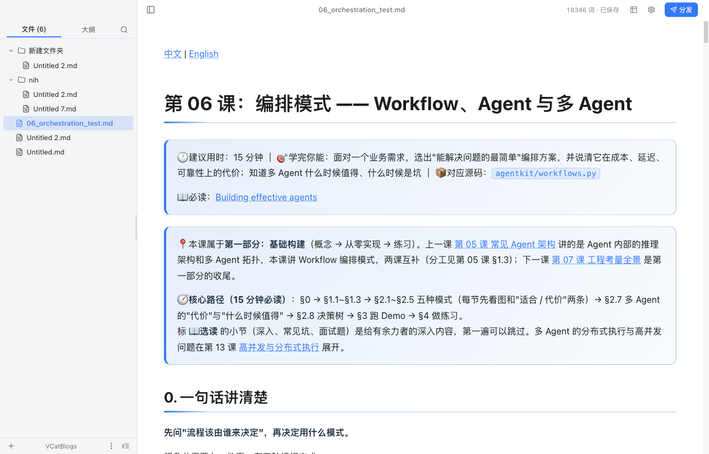
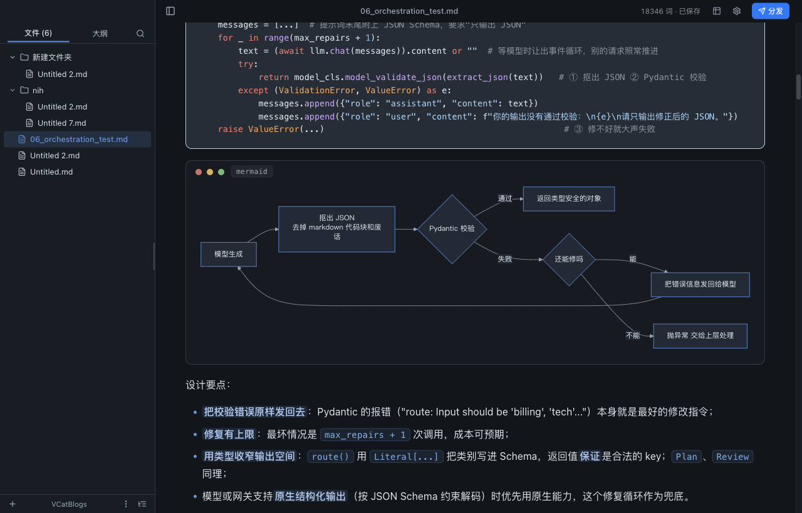
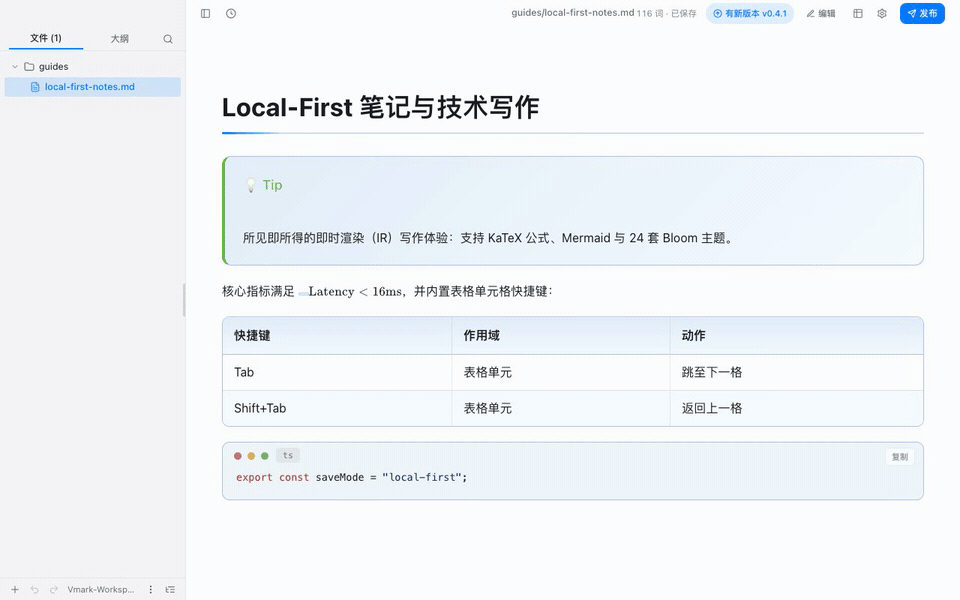
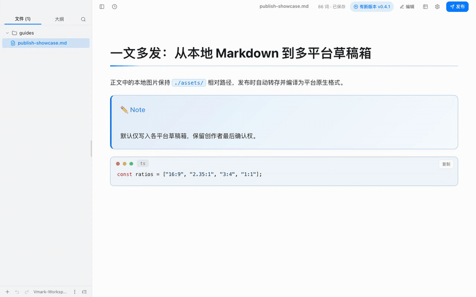
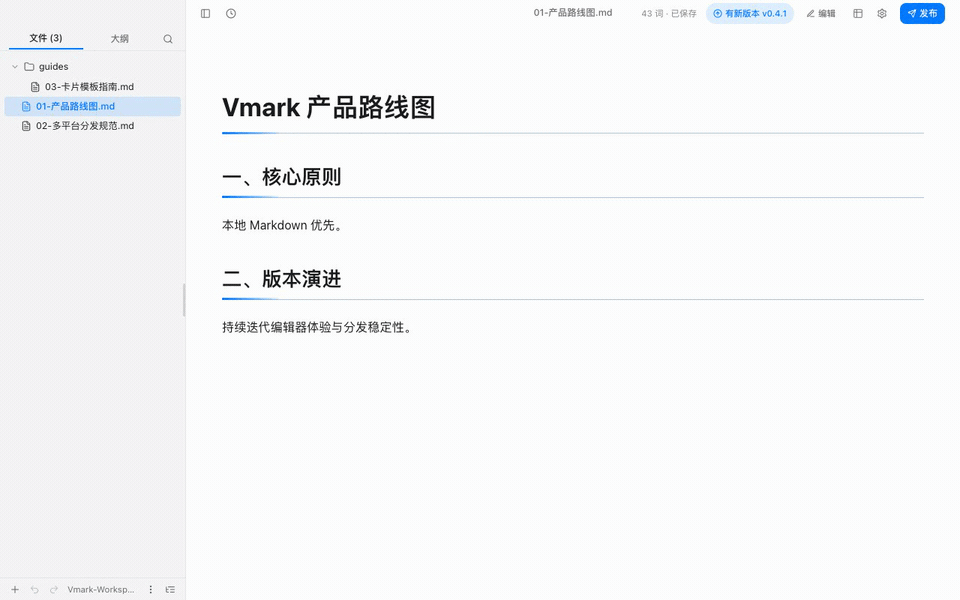
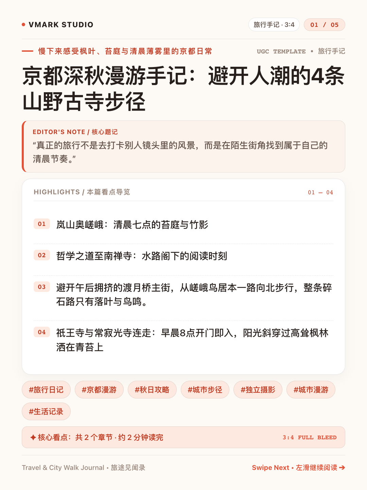
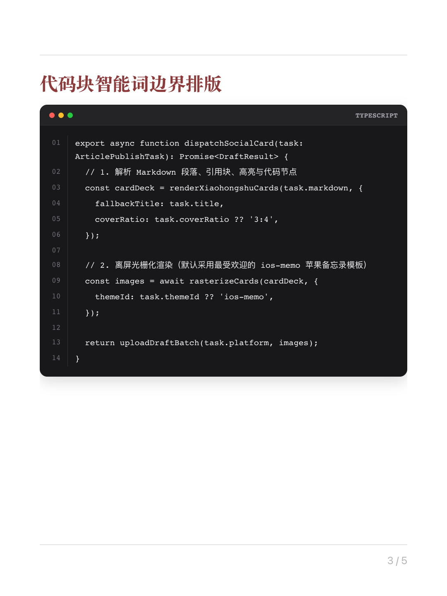
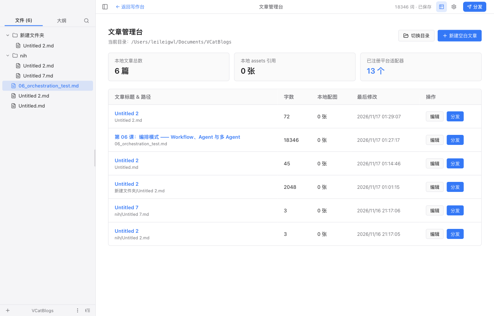

<div align="center">


# Vmark

[简体中文](README.md) | **English**

### Write one document, dispatch everywhere — with built-in anti-hotlink image migration & 3:4 cards for Xiaohongshu / Douyin

**A calm, Obsidian-style desktop document & Markdown editor paired with one-click multi-platform draft delivery. Skip manual image re-uploads, broken hotlinks, and repetitive web formatting:**
**Vmark automatically re-hosts local & hotlink-protected images to each platform, turns long-form notes into crisp 3:4 visual cards inside built-in browser flows for Xiaohongshu & Douyin, and saves clean drafts everywhere — leaving you one final click to publish.**

[](LICENSE)
[%20%7C%20Windows%20%C2%B7%20Linux%20(Experimental)-3b7cc4.svg)](https://github.com/leileigwl/vmark/releases/latest)
[](#-architecture--monorepo-layout)

[Official Website](https://vmark-6cc.pages.dev) · [Download Latest](https://github.com/leileigwl/vmark/releases/latest) · [Feature Demos](#-feature-demos) · [Write Once, Publish Everywhere](#-write-once-publish-everywhere) · [Desktop Writing Experience](#-smooth-desktop-writing--document-workspace) · [FAQ](#-faq)

<br />

| Light Document Workspace (Apple Light · File Tree + Outline + Callouts) | Dark Theme (Bloom Dark · Code Highlighting + Mermaid) |
| :---: | :---: |
|  |  |

</div>

---

## 🎬 Feature Demos

| Instant Rendering, Table Tab Jump & 24 Bloom Themes | Multi-Ratio Covers (16:9 · 2.35:1 · 3:4) & Draft Dispatch |
| :---: | :---: |
|  |  |

<div align="center">

| Workspace Manager · Quick Open (`⇧⌘O`) · Platform Accounts & Built-In Update Checker |
| :---: |
|  |

</div>

---

## 🚀 Write Once, Publish Everywhere

Writing technical docs, specs, or blog posts is the easy part — what slows creators down is uploading images ten times, watching hotlink-protected images break, and re-formatting in web editors. Vmark streamlines the entire delivery workflow:

1. **Automatic Anti-Hotlink Image Re-Hosting (Non-Destructive)**
   - Before saving drafts, Vmark reads local `./assets/` images and external hotlink-protected URLs **in memory** and uploads them directly to each platform's own media host (or your custom image bed) so images never break across portals — without ever touching your original `.md` file. Support for additional platforms is actively expanding.
2. **Built-In Browser Optimization for Xiaohongshu & Douyin (3:4 Visual Cards → One Click to Publish)**
   - Plain document screenshots rarely shine in visual feeds. Vmark includes a dedicated **1080×1440 (3:4) visual card engine** plus built-in browser automation tailored for Xiaohongshu and Douyin: it paginates directly from your content (with no redundant extra title cover card), uploads every card in order, fills title/body/`#tags`, and lands safely in your **Draft Box** so you can review and hit publish in one click.
   - **Community Attribution**: Our 3:4 card aesthetics draw inspiration from open-source community card templates, integrated and refined inside Vmark — heartfelt thanks to those creators.
3. **"Select All Ready", Shared Fields Once, Platform Options Kept Separate**
   - Automatically checks login sessions and required metadata across all 10 platforms with one-click **"Select All Ready"** — missing fields (like a WeChat cover or Juejin category) are clearly flagged without blocking ready platforms;
   - Fill **title, summary, and tags** once to share across platforms, while platform-specific settings (WeChat own cover, Juejin category, 3:4 card styles) stay cleanly independent; dispatch to all draft boxes together or target a single platform.
4. **Isolated Local Sessions, Theme-Synced Login Bar & Draft-First Safety**
   - Each platform runs in its own isolated persistent partition protected by OS-level credential encryption (`safeStorage`), with zero third-party relay servers. The built-in login window tracks your app's light/dark theme in real time and refreshes auth status automatically after sign-in. Content platforms default to **saving into your Draft Box** so you keep final review control.

<div align="center">

| Minimal Cover Card (3:4) | Ink Classic Cover | Frosted Dark Code Card |
| :---: | :---: | :---: |
|  |  |  |

</div>

### Supported Platform Matrix

| Dispatch Mode | Platforms | Capability |
| :--- | :--- | :--- |
| **Draft-First (Recommended)** | **WeChat Official Account**, **Zhihu**, **Juejin**, **CSDN**, **Cnblogs**, **Baijiahao**, **Weibo**, **Bilibili**, **Xiaohongshu**, **Douyin** | Anti-hotlink image re-hosting + platform-native markup & 3:4 cards saved straight into each Draft Box with verification |
| **Static Blogs Direct Push** | **GitHub Static Blogs** (Hexo / Hugo / VitePress / Astro) | One-click Git push for CI/CD static site workflows |
| **3:4 Visual Card Export** | **Xiaohongshu**, **Douyin**, **Social Carousel** | Offline high-DPI rasterization across multiple memo / editorial / code card themes |

---

## ✍️ Smooth Desktop Writing & Document Workspace

Even when you are just drafting internal docs or personal notes, Vmark aims to feel fast, calm, and thoughtful:

- **📖 Edit & Read-Only Modes + Image Lightbox Zoom**: Toggle seamlessly between **Edit Mode** and **Read-Only Mode**; click any image while reading to **zoom in, zoom out, or reset**.
- **⌨️ Effortless Keyboard Flow**: Quick-insert blocks via **`/` slash commands**, jump table cells or indent nested lists via **`Tab` / `Shift+Tab`**, delete smoothly across formatting boundaries or horizontal rules, and navigate inside code blocks.
- **📐 Technical & Visual Markdown**: Native inline **Mermaid flowcharts & sequence diagrams**, **KaTeX math**, GFM tables, syntax-highlighted code blocks, `[!NOTE]` / `[!TIP]` callouts, plus smart focal-point cover cropping (**16:9 / 2.35:1 / 1:1 / 3:4**).
- **🎨 24 Bloom Light/Dark Themes + Custom CSS (Community Attribution)**: Ships with 24 curated light & dark themes (inspired by beloved community editor themes and refined for Vmark) plus one-click custom `.css` import.
- **🗂️ Practical Workspace & Batch File Management**: Switch folders anytime, create blank articles on the fly, **batch-delete old drafts**, jump via the **clickable outline**, reveal files in your **OS file manager**, manage articles in an overview grid, and **pull published cloud articles back into plain `.md` files** with zero cloud lock-in.

<div align="center">



</div>

---

## 📦 Download & Local Development

### Desktop Installers

Download the installer from [GitHub Releases](https://github.com/leileigwl/vmark/releases/latest). **macOS is currently the primary recommended platform** (verified end-to-end on real hardware across editing and all 10 draft-box workflows). Windows and Linux builds are generated via CI as experimental releases for early testing and will receive deeper adaptation in upcoming versions:

| OS | Support Tier | Format | Notes |
| :--- | :--- | :--- | :--- |
| **macOS** (Apple Silicon / Intel) | **Primary (End-to-End Verified)** | `.dmg` / `.zip` | Drag into `Applications`; for unsigned Gatekeeper warnings, allow via System Settings → Privacy & Security |
| **Windows** (x64) | Experimental (Ongoing) | `.exe` | Credentials protected via Windows DPAPI (`safeStorage`); ongoing cross-platform polish |
| **Linux** (Ubuntu / Debian) | Experimental (Ongoing) | `.AppImage` / `.deb` | Make `.AppImage` executable or install via `dpkg -i` |

### Roadmap

- Deepen **Windows and Linux** real-device adaptation and shortcut parity;
- Expand **supported publishing platforms & custom image-bed hosts**, while polishing file import/export edge cases;
- Continuously track creator portal updates to keep auth detection and draft delivery reliable.

### Local Development

Prerequisites: **Node.js >= 20.0.0** and **pnpm >= 9.0.0** (`pnpm` only across the repository).

```bash
# 1. Clone and install dependencies
git clone https://github.com/leileigwl/vmark.git
cd vmark
pnpm install

# 2. Run desktop app in development mode (Electron + Vite HMR)
pnpm dev

# 3. Typecheck, test, and build
pnpm typecheck
pnpm test
pnpm build
```

> **Showcase Website (`website/`)**: An independent bilingual product showcase built with Vite, React, and Tailwind CSS, ready for Cloudflare Pages with automatic `sitemap.xml` / `robots.txt` / `llms.txt` URL syncing. See [website/DEPLOY.md](website/DEPLOY.md).

---

## 🏗️ Architecture & Monorepo Layout

Built as a layered `pnpm workspace + Turborepo` monorepo. See [PRODUCT.md](docs/PRODUCT.md) and [ARCHITECTURE.md](docs/ARCHITECTURE.md).

<details>
<summary>Expand Monorepo Structure</summary>

```text
vmark/
├── apps/
│   └── desktop/                  # Electron + Vite + React 18 desktop app
│       ├── src/main/             # Main process: filesystem, IPC, isolated sessions, auto-updater
│       ├── src/preload/          # Secure preload bridge
│       └── src/renderer/         # Renderer: Vditor IR editor, Bloom themes, manager, publish flow
├── packages/
│   ├── shared/                   # Shared TypeScript contracts and platform models
│   ├── core/                     # Directory scan, outline parser, AST renderers & 3:4 card engine
│   ├── image-pipeline/           # Local ./assets/ manager, anti-hotlink proxy & fallback hosts
│   └── adapters/                 # Multi-platform auth checks & draft dispatch adapters
├── website/                      # Official showcase site (SEO / GEO / Cloudflare Pages)
├── docs/                         # Product specs, UI guidelines & design docs
└── openspec/                     # Spec-driven change proposals
```

</details>

---

## ❓ FAQ

- **Q: How does anti-hotlink image migration work, and will it modify my original Markdown file?**  
  A: Never. At publish time, Vmark reads local `./assets/` images and external hotlink-protected URLs in memory, uploads them to each platform's own image host, and puts those hosted URLs only into the dispatched draft — your `.md` source file on disk stays completely untouched.
- **Q: Will one-click dispatch accidentally publish publicly, and are my cookies safe?**  
  A: All 10 supported content platforms default to saving in your **Draft Box**, so you always review and publish manually. Every platform session lives in a separate local partition encrypted by OS security storage (such as macOS Keychain or Windows DPAPI), with zero third-party relay servers.
- **Q: How do Xiaohongshu & Douyin work without official article APIs, and which OS is best supported today?**  
  A: Vmark renders your note into crisp **1080×1440 (3:4) visual cards** alongside clean segmented text and `#tags`, then automates uploading and saving directly into Xiaohongshu and Douyin's draft boxes via its built-in isolated browser. **macOS (Apple Silicon / Intel)** is the primary verified platform today; Windows and Linux builds are experimental.

---

## 📄 Dual License (Open Source + Commercial)

Vmark is dual-licensed under **GNU AGPL-3.0-only** and a **Commercial License**:

- **Open Source**: Free for personal study, research, and AGPL-3.0 compliant open-source projects under [LICENSE](LICENSE).
- **Commercial**: Closed-source integration, proprietary distributions, or closed commercial services require a commercial license. See [LICENSE-COMMERCIAL.md](LICENSE-COMMERCIAL.md).
