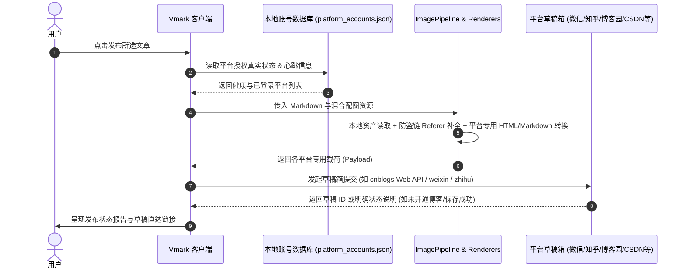

# Vmark 标杆测试文章与全平台分发排版技术规范

> 本文档根据用户确认的方案 A（硬核技术长文 + 社媒实战图文笔记）及混合配图模式，制定标杆文章的内容结构、元数据规范及 5 大平台排版转换与推送落地契约。

---

## 1. 标杆文章元数据与结构规范

### 1.1 文章一：《现代富文本与 AST 渲染管线演进：从 Markdown 到多平台高保真分发》
* **定位**：检验深度技术教程、复杂语法、代码块与长篇排版在各平台的解析稳定性。
* **主要特性覆盖**：
  * **Frontmatter**：完整的 YAML 头信息（标题、多标签、主分类、作者、摘要、本地封面图路径、正文注入开关）。
  * **Mac 风格多语言代码块**：覆盖 TypeScript、Rust、CSS、Shell 等语言的高亮与格式保留。
  * **复杂结构**：标准 Markdown 表格、引用提示框（`> [!NOTE]`、`> [!TIP]`、`> [!WARNING]`）。
  * **混合配图**：本地 `assets/architecture-diagram.png` 架构示意图 + 高可用合规外部 CDN 配图。
  * **外链检测**：包含内部锚点与外部安全链接，专门用于检验微信公众号的「外链转文末脚注」算法。

### 1.2 文章二：《独立开发者的高效内容矩阵：1 套 Markdown 驱动 5 大平台极速分发》
* **定位**：检验敏捷图文速记、要点提炼、社媒标签生成及小红书 3:4 视觉卡片切片效果。
* **主要特性覆盖**：
  * **小红书 3:4 视觉卡片生成**：
    * 卡片 1（封面卡片）：大字主标题 + 副标题 + 视觉徽章 + 标签矩阵。
    * 卡片 2~3（核心方法与步骤）：清晰的带序号要点，字体适宜移动端阅读。
    * 卡片 4（配置与代码片段）：深色磨砂背景的代码高亮卡片。
  * **提炼发布文案**：截取 600~800 字精简摘要，文末自动追加 `#独立开发 #技术写作 #效率工具` 等小红书热搜标签。

---

## 2. 5 大平台排版转换与适配契约

| 目标平台 | 输入与处理契约 | 代码块视觉 | 图片处理 | 外部链接与扩展特性 |
| :--- | :--- | :--- | :--- | :--- |
| **微信公众号** | `renderWeixinHtml` 全内联 CSS | Mac 三色红黄绿圆点，`#1e1e1e` 深灰背景，横向滚动 | 转存为微信永久 `mmbiz.qpic.cn` | 外链自动转换为文末带序号的「参考资料（Footnotes）」 |
| **知乎专栏** | `renderZhihuHtml` | 原生 Prism `<pre><code class="language-*">` | 自动转为 `<figure></figure>` | 正文 `# H1` 自动降级为 `## H2`，符合知乎大纲树规范 |
| **博客园** | 原生 GFM Markdown | 原生 fenced code blocks | MetaWeblog / Web 接口安全转存 | 剔除冗余 Frontmatter，正文无缝衔接用户博客园皮肤 |
| **稀土掘金** | `mark_content` 纯净 Markdown | 原生 fenced code blocks | 走掘金/字节 CDN 上传转存 | 自动映射掘金常用分类 ID（如前端、后端开发） |
| **小红书** | `renderXiaohongshuCards` | 独立暗黑磨砂代码卡片 | 生成 3:4（1080×1440）多图卡片轮播图集 | 自动提取正文要点与标签，生成一键粘贴文案 |

---

## 3. 真实推送与草稿箱生命周期流程

1. **草稿模式优先**：所有平台默认且强制推入草稿箱，禁止静默公开发布。
2. **错误自愈与明确反馈**：若平台返回业务受限（如博客园返回 `您没有开通博客！`），系统明确提示开通方式并保留现场，不产生误导性失败。
