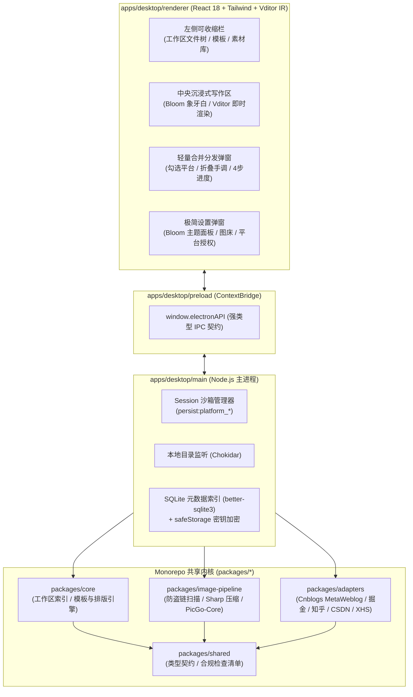
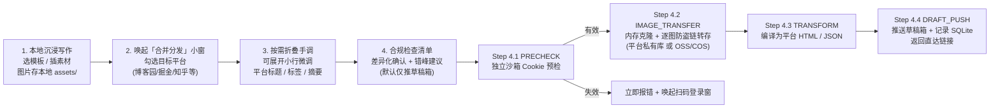

# 样式规范、业务流程与系统框架图（Step 1 视觉门控基准）

> 本文档为前端开发前置门控 **Step 1**：在进入 Figma 草图绘制、标准视觉稿生成与前端开发前，先锁定系统的**框架图、核心业务流程图、三段式布局框架以及双主题视觉样式规范**。

---

## 一、 系统总体框架图（Monorepo + Electron 架构）

---

## 二、 核心业务与合规分发流程图

---

## 三、 极简沉浸 UI 规划与 Bloom 视觉样式规范

### 1. 核心界面布局与 Typora 原版经典白色风格
直接学习并复用本地 Typora 原版 [`github.css`](file:///Users/leileigwl/Library/Application Support/abnerworks.Typora/themes/github.css) 的清爽白色风格，**提供完整的内容管理平台视图 + 极简写作台**：
1. **三大顶层视图切换（顶部极简标签）**：
   - **「写作台」**：纯白画布（`#ffffff`）+ 可收缩左侧栏（`#fafafa`，文件树/模板/素材/+一键导入），极致专注写文章。
   - **「文章管理」**：**完整的管理平台表格视图（Table）**，集中管理工作区内所有本地文章、字数、标签，以及每个平台（博客园/掘金/知乎/CSDN）的同步状态、草稿直达链接与一键分发/批量检查。
   - **「设置与对接」**：集中配置图床策略（`assets/` 本地优先 + OSS/COS/S3/PicGo）、平台对接授权（博客园 MetaWeblog / 独立沙箱登录）与外观选项。
2. **轻量合并分发弹窗（在写作台或管理台点击“分发”时弹出）**：
   - 勾选目标平台 + 按需展开小行微调单平台标题/标签 + 实时展示 4 步分发中间过程（鉴权预检 $\rightarrow$ 缓存命中/图片防盗链转存 $\rightarrow$ 格式编译 $\rightarrow$ 推入草稿箱）。

### 2. 真实提取的 Typora 原版白色 CSS Token 规范（参考 `github.css`）

| 语义变量 | 色值 (`github.css`) | 说明 |
| :--- | :--- | :--- |
| **主画布背景** | `#ffffff` | 纯净白写作与管理台主底色 |
| **侧边栏 / 表头底色 (`--side-bar-bg-color`)** | `#fafafa` | 左侧栏与表格表头极浅灰 |
| **主文字颜色** | `rgb(51, 51, 51)` (`#333333`) | 经典高可读深灰黑 |
| **次要文字 (`--control-text-color`)** | `#777777` | 字数、时间戳、辅助图标 |
| **交互主色 / 链接 (`a`)** | `#4183C4` | 经典 Typora 蓝，主按钮、链接与激活态 |
| **边框与分割线** | `#e5e7eb` / `#eeeeee` | 1px 干净细线 |
| **字体栈** | `"Open Sans", "PingFang SC", "Helvetica Neue", sans-serif` | 清爽中英文混排，`font-size: 16px; line-height: 1.6;` |

### 3. 排版与交互规范
- **字体栈**：
  - UI 与正文：`Inter`, `"PingFang SC"`, `"Hiragino Sans GB"`, `"Microsoft YaHei"`, sans-serif
  - 代码与 Markdown 源码：`JetBrains Mono`, `"Fira Code"`, monospace
- **沉浸感原则**：
  - 左侧边栏（默认 `240px`）与右侧分发抽屉（默认 `320px`）均支持一键折叠快捷键（如 `Cmd+\` 与 `Cmd+Shift+P`），折叠后进入全屏专注写作模式。
  - **禁止使用杂乱 Emoji 作为图标**，全站统一使用 `lucide-react` 线性矢量图标（1.5px 描边）。

---

## 四、 Figma 草图绘制清单（下一步 Step 2）

在进入标准视觉稿与前端开发前，Figma 草图需覆盖以下 4 个核心画面：
1. **核心写作台视图**：含左侧文件树/素材切换 + 中央 Vditor 即时渲染 + 右侧 AI 差异化与 4 步进度抽屉。
2. **账号沙箱管理视图**：展示博客园、掘金、知乎、CSDN（以及 P1 标注的小红书高风控提示）卡片、在线状态与独立登录窗唤起。
3. **图床与防盗链策略设置视图**：展示「平台私有素材直传优先」vs「自配 OSS/COS/GitHub/S3」及 BYOK 大模型密钥加密配置。
4. **同步历史与反向导入弹窗**：输入博客园文章 URL 一键抓取预览并落盘。
