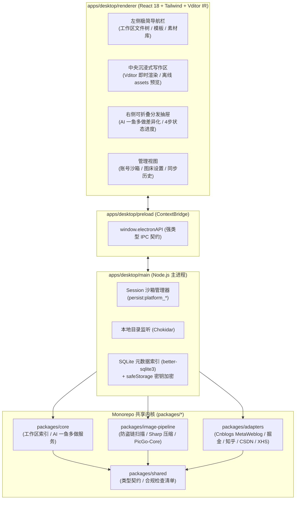

# 样式规范、业务流程与系统框架图（Step 1 视觉门控基准）

> 本文档为前端开发前置门控 **Step 1**：在进入 Figma 草图绘制、标准视觉稿生成与前端开发前，先锁定系统的**框架图、核心业务流程图、三段式布局框架以及双主题视觉样式规范**。

---

## 一、 系统总体框架图（Monorepo + Electron 架构）



---

## 二、 核心业务与合规分发流程图


---

## 三、 页面框架图与视觉样式规范（Style Guide）

### 1. 主界面三段式框架（极简沉浸工作台）

```text
+-----------------------------------------------------------------------------------+
| [● ● ●]  VCat Publisher   [写作台] [账号沙箱] [图床配置] [同步历史]    [☀/🌙] [账户] |  <- 顶部极简导航栏 (44px)
+-----------------+----------------------------------------+------------------------+
|  工作区 / 模板  |                                        |  合规分发 & 差异化面板 |
|                 |     # 文章标题（类似 Typora 即时渲染）  |                        |
|  ▼ 我的博客     |                                        |  [x] 博客园 (在线)     |
|    📄 架构.md   |     正文内容在这里沉浸式撰写，支持      |      标题: [差异化...] |
|    📄 复盘.md   |     Callout、代码块、本地 assets 贴图   |  [x] 掘金   (在线)     |
|    📁 assets/   |                                        |      [✨ AI 一鱼多做]   |
|                 |     > 光标离开即刻渲染为精美排版        |                        |
|  -------------  |                                        |  ---- 4 步实时日志 ---- |
|  [模板] [素材]  |                                        |  ✅ 1. 鉴权预检通过    |
|  + 技术方案     |                                        |  🔄 2. 转存图片 (2/3)  |
|  + 引流签名档   |                                        |  [一键推送到草稿箱]    |
+-----------------+----------------------------------------+------------------------+
|  本地工作区: ~/Blogs  |  1,842 字  |  图床: 平台私有直传优先  |  所有本地更改已保存  |  <- 底部极简状态栏 (26px)
+-----------------------------------------------------------------------------------+
```

### 2. 双主题色板（Color Tokens，融合 FlowCanvas 暖象牙 + Typora 纯净感）

| 语义角色 | 浅色主题（Light · 暖象牙工作室） | 暗色主题（Dark · 极简深碳） | 用途说明 |
| :--- | :--- | :--- | :--- |
| **主背景 (`bg-canvas`)** | `#F8F7F4` (暖象牙) | `#121214` (深炭黑) | 整体窗口与边栏底色 |
| **写作画布 (`bg-editor`)** | `#FFFFFF` (纯净白) | `#18181B` (哑光黑) | 中央 Vditor 写作纸张区域，高对比护眼 |
| **浮层/卡片 (`bg-surface`)** | `#F1EFEA` / `rgba(255,255,255,0.85)` | `#202024` | 模板卡片、分发抽屉、模态弹窗 |
| **边框分割 (`border-subtle`)** | `#E5E2DC` | `#27272A` | 1px 极细分割线，避免重阴影 |
| **主文字 (`text-primary`)** | `#1C1917` (深墨色) | `#F4F4F5` | 正文与标题 |
| **次要文字 (`text-muted`)** | `#78716C` | `#A1A1AA` | 字数统计、同步时间戳、提示词 |
| **品牌主色 (`accent-primary`)** | `#2563EB` (精密克莱因蓝) | `#3B82F6` | 主操作按钮（一键推送草稿）、激活态边框 |
| **状态语义色** | 成功 `#16A34A` / 警告 `#D97706` / 危险 `#DC2626` | 同右提亮版 | 平台在线绿点、高风控警示、4步日志报错 |

### 3. 排版与交互规范
- **字体栈**：
  - UI 与正文：`Inter`, `"PingFang SC"`, `"Hiragino Sans GB"`, `"Microsoft YaHei"`, sans-serif
  - 代码与 Markdown 源码：`JetBrains Mono`, `"Fira Code"`, monospace
- **沉浸感原则**：
  - 左侧边栏（默认 `240px`）与右侧分发抽屉（默认 `320px`）均支持一键折叠快捷键（如 `Cmd+\` 与 `Cmd+Shift+P`），折叠后进入全屏专注写作模式。
  - **禁止使用杂乱 Emoji 作为图标**，全站统一使用 `lucide-react` 线性矢量图标（1.5px 描边）。

---

## 四、 Figma 草图绘制清单（下一步 Step 2）

在进入标准视觉稿与前端开发前，Figma 草图需覆盖以下 4 个核心画面：
1. **核心写作台视图**：含左侧文件树/素材切换 + 中央 Vditor 即时渲染 + 右侧 AI 差异化与 4 步进度抽屉。
2. **账号沙箱管理视图**：展示博客园、掘金、知乎、CSDN（以及 P1 标注的小红书高风控提示）卡片、在线状态与独立登录窗唤起。
3. **图床与防盗链策略设置视图**：展示「平台私有素材直传优先」vs「自配 OSS/COS/GitHub/S3」及 BYOK 大模型密钥加密配置。
4. **同步历史与反向导入弹窗**：输入博客园文章 URL 一键抓取预览并落盘。
