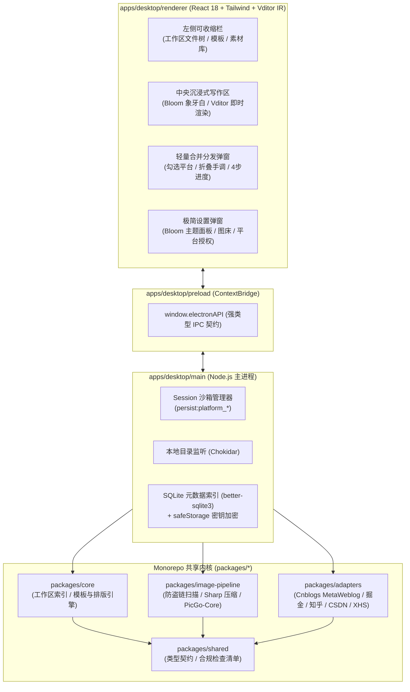
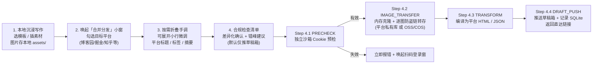

# 样式规范、业务流程与系统框架图（Step 1 视觉门控基准）

> 本文档为前端开发前置门控 **Step 1**：在进入 Figma 草图绘制、标准视觉稿生成与前端开发前，先锁定系统的**框架图、核心业务流程图、三段式布局框架以及双主题视觉样式规范**。

---

## 一、 系统总体框架图（Monorepo + Electron 架构）

---

## 二、 核心业务与合规分发流程图

---

## 三、 极简沉浸 UI 规划与 Bloom 视觉样式规范

### 1. 核心界面布局与“铺满无框”极简哲学
直接提取并复用本地 Typora [`bloom-lapis.css`](file:///Users/leileigwl/Library/Application Support/abnerworks.Typora/themes/bloom-lapis.css) 与 [`bloom-wheat.css`](file:///Users/leileigwl/Library/Application Support/abnerworks.Typora/themes/bloom-wheat.css) 的真实设计系统，**彻底去掉多余的软件账号体系与 AI 依赖**：
1. **无边框铺满式画布（Full-Bleed Canvas）**：
   - 取消 `740px` 居中卡片的边框、圆角和阴影（`max-width: none; border: none; border-radius: 0; box-shadow: none;`），让写作区自然铺满整个视口，顶部保留 Bloom 标志性的柔和线性渐变光晕（`linear-gradient(180deg, var(--accent-soft), transparent 460px)`）。
2. **默认极简写作态（左右全收起）**：
   - 顶部仅保留极淡的线性图标（展开左栏、选模板/一键导入、外观主题面板、合并分发小窗、设置）。
3. **左侧栏（List 面板，可随时收缩隐藏）**：
   - 切换 **「文件树 / 大纲」** 与 **「本地模板 & 素材库」**；底部提供「+ 一键导入」抓取线上文章。
4. **轻量合并分发小窗（点击分发图标弹出，不占主界面）**：
   - 勾选博客园、掘金、知乎等平台；如需微调单平台标题/标签，点击折叠小行手调即可；下方展示 4 步实时状态进度，一键推入平台草稿箱。
5. **独立「设置」弹窗（全功能配齐）**：
   - **外观与主题**：直接复刻 Bloom 的 **12 浅 12 深 CSS 变量主题**（默认象牙白 `Wheat #f7f5f1` 与清澈文档蓝 `Lapis #2f62ac`），支持极简模式与字号/行距调节。
   - **图床与资产**：本地 `assets/` 目录策略、平台私有直传优先开关、PicGo/OSS/COS/S3/GitHub 配置。
   - **平台对接**：博客园（MetaWeblog）、掘金、知乎、CSDN 本地沙箱授权状态维护。

### 2. 真实提取的 Bloom CSS Token 规范（8px 原子间距 + MiSans 字体）

| 语义变量 | 象牙白 (`bloom-wheat.css`) | 文档蓝 (`bloom-lapis.css`) | 说明 |
| :--- | :--- | :--- | :--- |
| **`--bg` / `--bg-color`** | `#f7f5f1` | `#f3f7fa` | 整体铺满背景底色 |
| **`--surface` / `--surface-2`** | `#f1eee9` / `#e9e4dc` | `#ecf1f5` / `#dfe7ee` | 左侧边栏、代码区、浮层卡片底色 |
| **`--text` / `--text-semi`** | `#262118` / `#5a544a` | `#161e26` / `#48515b` | 正文主文字与次级文字 |
| **`--accent` / `--accent-soft`** | `#836d43` / `rgba(131,109,67,0.12)` | `#2f62ac` / `rgba(47,98,172,0.12)` | 主题点缀色与顶部氛围渐变光晕 |
| **`--border`** | `rgba(38,33,24,0.1)` | `rgba(22,30,38,0.1)` | 1px 极细分割线 |
| **字体栈 (`--font-sans`)** | `"MiSans", "PingFang SC", "Microsoft YaHei", sans-serif` | 同左 | 复用 `bloom/fonts/MiSans-*.ttf` |
| **行高与字号** | `font-size: 16px; line-height: 1.8;` | 同左 | 舒适长文阅读与编辑密度 |

### 3. 排版与交互规范
- **字体栈**：
  - UI 与正文：`Inter`, `"PingFang SC"`, `"Hiragino Sans GB"`, `"Microsoft YaHei"`, sans-serif
  - 代码与 Markdown 源码：`JetBrains Mono`, `"Fira Code"`, monospace
- **沉浸感原则**：
  - 左侧边栏（默认 `240px`）与右侧分发抽屉（默认 `320px`）均支持一键折叠快捷键（如 `Cmd+\` 与 `Cmd+Shift+P`），折叠后进入全屏专注写作模式。
  - **禁止使用杂乱 Emoji 作为图标**，全站统一使用 `lucide-react` 线性矢量图标（1.5px 描边）。

---

## 四、 Figma 草图绘制清单（下一步 Step 2）

在进入标准视觉稿与前端开发前，Figma 草图需覆盖以下 4 个核心画面：
1. **核心写作台视图**：含左侧文件树/素材切换 + 中央 Vditor 即时渲染 + 右侧 AI 差异化与 4 步进度抽屉。
2. **账号沙箱管理视图**：展示博客园、掘金、知乎、CSDN（以及 P1 标注的小红书高风控提示）卡片、在线状态与独立登录窗唤起。
3. **图床与防盗链策略设置视图**：展示「平台私有素材直传优先」vs「自配 OSS/COS/GitHub/S3」及 BYOK 大模型密钥加密配置。
4. **同步历史与反向导入弹窗**：输入博客园文章 URL 一键抓取预览并落盘。
