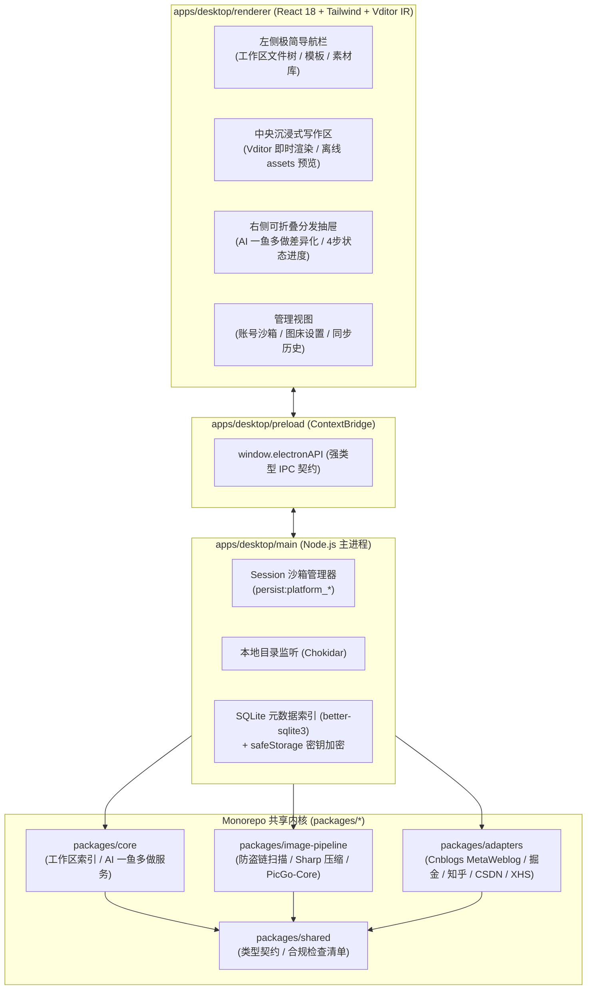

# 样式规范、业务流程与系统框架图（Step 1 视觉门控基准）

> 本文档为前端开发前置门控 **Step 1**：在进入 Figma 草图绘制、标准视觉稿生成与前端开发前，先锁定系统的**框架图、核心业务流程图、三段式布局框架以及双主题视觉样式规范**。

---

## 一、 系统总体框架图（Monorepo + Electron 架构）

---

## 二、 核心业务与合规分发流程图

---

## 三、 极简沉浸 UI 规划与 Bloom 视觉样式规范

### 1. 核心界面布局与“可收缩”极简哲学
参考 **Typora + Bloom 主题** 的极致克制体验，**彻底去掉多余的软件账号体系**，开源本地打开即用：
1. **默认极简写作态（左右全收起）**：
   - 画面中只有一张温润的**象牙白阅读纸张**（居中 40 字最优中文行宽），顶部仅保留极隐蔽的窗口标题与几个微弱线性图标（展开左栏、选模板/一键导入、打开分发、设置）。
2. **左侧栏（List 面板，可随时收缩隐藏）**：
   - 切换 **「文件树 / 大纲」** 与 **「本地模板 & 素材库」**。点击模板立即在当前工作区生成骨架文章；点击“一键导入”弹窗粘贴线上 URL 直接转录本地 `.md`。
3. **右侧栏（Table / 合并分发面板，平时默认收起）**：
   - 写完文章点击右上角「分发」按钮再滑出：上方是 AI 一鱼多做（按平台微调标题/导语/标签），下方是 4 步实时状态进度条，一键推送至各平台草稿箱。
4. **独立「设置」弹窗（全功能配齐）**：
   - **外观与主题（对标 Bloom 主题面板）**：内置莫兰迪 12 浅 12 深配色圆点选择器（默认**象牙白 Wheat / Ivory**），支持一键切换浅/深模式、极简专注模式开关与行宽调节。
   - **图床与资产**：本地 `assets/` 目录策略、平台私有上传优先开关、PicGo/OSS/COS/S3/GitHub 凭据配置。
   - **平台对接**：博客园（MetaWeblog）、掘金、知乎、CSDN 的本地独立沙箱登录状态维护与连通测试（无需软件自身账号）。
   - **AI 一鱼多做（BYOK）**：大模型 API Key 加密配置与各平台默认改写提示词。

### 2. 双主题色板（对标 `Bloom · OKLCH 莫兰迪色系`）

| 语义角色 | 默认浅色（象牙白 · Wheat/Ivory） | 默认暗色（墨韵 · Ink Dark） | 莫兰迪扩展主题家族 |
| :--- | :--- | :--- | :--- |
| **主背景 (`bg-canvas`)** | `#F7F5F0` (温润象牙白) | `#161618` (柔墨炭) | 支持 Petal(花瓣) / Mist(迷雾) / Sage(鼠尾草) / Lapis(青金石) 等 12 色系一键切换 |
| **写作画布 (`bg-editor`)** | `#FCFBF8` (米白纸张) | `#1C1C1F` (暗纸张) | 严格通过 WCAG AAA 对比度校验，久写不刺眼 |
| **浮层/卡片 (`bg-surface`)** | `#EFECE4` | `#242428` | 设置弹窗、模板卡片、收缩侧栏 |
| **边框分割 (`border-subtle`)** | `#E4DFD5` | `#2E2E34` | 1px 极轻分割线，无重阴影 |
| **主文字 (`text-primary`)** | `#2C2A29` (温润墨色) | `#EAE8E3` | 正文与标题 |
| **点缀主色 (`accent-primary`)** | 跟随所选莫兰迪主题色（如琥珀/青金石/鼠尾草） | 同左低饱和提亮版 | 主操作按钮、激活态边框、选中圆点 |

### 3. 排版与交互规范
- **字体栈**：
  - UI 与正文：`Inter`, `"PingFang SC"`, `"Hiragino Sans GB"`, `"Microsoft YaHei"`, sans-serif
  - 代码与 Markdown 源码：`JetBrains Mono`, `"Fira Code"`, monospace
- **沉浸感原则**：
  - 左侧边栏（默认 `240px`）与右侧分发抽屉（默认 `320px`）均支持一键折叠快捷键（如 `Cmd+\` 与 `Cmd+Shift+P`），折叠后进入全屏专注写作模式。
  - **禁止使用杂乱 Emoji 作为图标**，全站统一使用 `lucide-react` 线性矢量图标（1.5px 描边）。

---

## 四、 Figma 草图绘制清单（下一步 Step 2）

在进入标准视觉稿与前端开发前，Figma 草图需覆盖以下 4 个核心画面：
1. **核心写作台视图**：含左侧文件树/素材切换 + 中央 Vditor 即时渲染 + 右侧 AI 差异化与 4 步进度抽屉。
2. **账号沙箱管理视图**：展示博客园、掘金、知乎、CSDN（以及 P1 标注的小红书高风控提示）卡片、在线状态与独立登录窗唤起。
3. **图床与防盗链策略设置视图**：展示「平台私有素材直传优先」vs「自配 OSS/COS/GitHub/S3」及 BYOK 大模型密钥加密配置。
4. **同步历史与反向导入弹窗**：输入博客园文章 URL 一键抓取预览并落盘。
