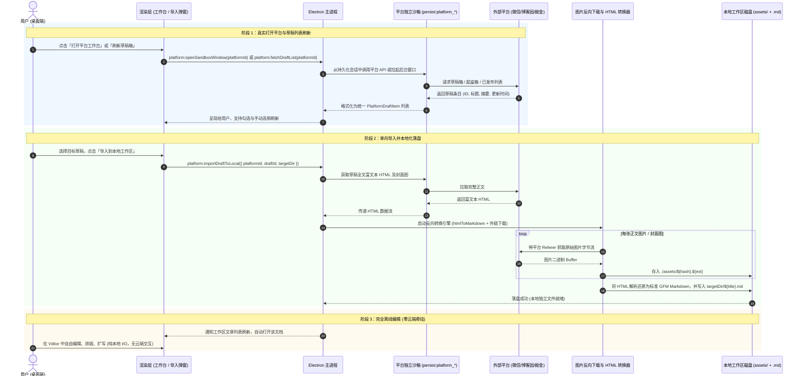

# 平台草稿反向导入与本地独立草稿管理技术方案（Platform Draft Ingestion & Local-First Management Plan）

- **文档状态**：规划与设计就绪（Planning & Architecture Design）
- **适用版本**：Vmark Desktop Phase 2.3+
- **核心定位**：解决多平台已有草稿与历史文章的“真实打开查看 $\rightarrow$ 单向拉取导入 $\rightarrow$ 本地 Markdown 独立管理 $\rightarrow$ 需分发时单向推送”全流程闭环。

---

## 一、核心原则与设计边界（Design Tenets & Boundaries）

### 1. 本地优先与单向解耦原则（Local-First Decoupling）
- **坚决不做双向云端强同步**：
  - 传统工具试图在本地与各平台云端建立双向实时同步（如监听云端更新覆盖本地，或本地打字实时 PATCH 云端），极易引发状态冲突、网络死锁、平台风控拦截与意外覆盖。
  - **Vmark 规范**：从平台草稿箱导入后，文章在本地工作区生成独立的 `.md` 文件与 `./assets/` 图片，**彻底切断与云端的实时连接**，所有编辑、重命名、大纲管理、文件移动 100% 运行在本地文件系统，用户拥有绝对的数据掌控权。
- **云端连接职责的极简收敛**：
  云端连接**仅且严格**负责以下三个离散行为，杜绝任何常驻静默网络进程：
  1. **授权与会话托管**：独立沙箱（`persist:platform_${platformId}`）管理 Cookie 与 Token 探针。
  2. **单向分发与草稿推送**：本地 Markdown + 图片防盗链转存 $\rightarrow$ 推入平台草稿箱或直接发布。
  3. **按需单向拉取导入**：用户在界面中主动点击“刷新/导入草稿”时，拉取一份最新副本到本地，完成后立即断开。

---

## 二、系统架构与数据流转全景



---

## 三、四大核心模块深度设计

### 1. 真实平台工作台沙箱（Interactive Platform Sandbox）
- **多会话持久隔离**：每个平台（微信、博客园、掘金、知乎等）运行在独立的 `persist:platform_${platformId}` Electron Session 中。
- **可视化独立工作台**：
  - 在「平台授权托管」界面，除现有「扫码登录」外，新增「打开平台工作台」按钮；
  - 启动带有沉浸式顶部快捷工具栏的完整 BrowserWindow，支持用户像在浏览器中一样直接在后台编辑草稿、查看数据、管理草稿箱。
  - 用户在沙箱内的登录续期、验证码校验等状态实时被持久化到本地 Session，彻底杜绝 Cookie 丢失与多账号串号。

### 2. 草稿箱与文章列表实时提取适配器（Draft Ingestion Adapters）
在 `@vcat/adapters` 抽象层为 `PlatformAdapter` 补充只读数据提取接口：

```typescript
export interface PlatformDraftItem {
  draftId: string;
  title: string;
  digest?: string;
  coverImageUrl?: string;
  updatedAt: number;
  category: 'draft' | 'published';
  sourceUrl?: string;
  rawPayload?: unknown;
}

export interface PlatformDraftDetail {
  draftId: string;
  title: string;
  htmlContent: string;
  coverImageUrl?: string;
  tags?: string[];
  author?: string;
  digest?: string;
}

// 扩展后的适配器只读契约
export interface PlatformIngestionSupport {
  fetchDrafts(): Promise<PlatformDraftItem[]>;
  getDraftDetail(draftId: string): Promise<PlatformDraftDetail>;
}
```

- **微信公众号（mp.weixin.qq.com）**：
  - 基于持久化 Session，调用图文草稿箱分页接口 `cgi-bin/draft?action=get_draft_list`，提取标题、草稿 ID、封面、图文更新时间。
- **博客园（Cnblogs）**：
  - 基于 MetaWeblog XML-RPC `metaWeblog.getRecentPosts(username, password, 50)`，同时获取草稿与已发布文章。
- **其他平台（掘金、知乎、CSDN、Linux.do）**：
  - 分别基于对应创作者中心的 REST 接口获取个人文章/草稿索引。

### 3. 反向富文本转换与防盗链图片落地管线（HTML-to-Markdown & Asset Materialization）
- **HTML 清洗与 Markdown 重建**：
  - 将微信公众号等平台特定的私有标签（如 `<mp-style-type>`, `<section data-role="outer">`, `<span style="font-size:...">`）清洗规范化；
  - 将正文标题、加粗、斜体、列表、代码块、表格转换为纯净 GitHub Flavored Markdown；
  - 提取代码块中的真实代码内容，剥离平台包裹的行号与修饰元素。
- **外链图片全量落盘（Asset Materialization）**：
  - 遍历转换后的所有图片链接（包括 `mmbiz.qpic.cn`、`zhimg.com`、`csdnimg.cn` 等第三方外链）；
  - 调用 `resolveRefererForUrl(src)` 注入目标来源 `Referer` 与合规 `User-Agent`，将远程二进制数据拉取到本地；
  - 写入工作区本地 `./assets/${Date.now()}-${hash}.${ext}`；
  - 将 Markdown 中的外链无损改写为 `./assets/xxx.png`。
  - **结果**：导入完成后的文章，断网离线也能完整打开，文字与图片 100% 存在于本地。

### 4. 本地草稿库结构与解耦规范
- **导入目录规约**：
  - 默认导入至当前工作区下的 `_drafts/${platformName}/` 目录（例如 `_drafts/微信公众号/2026-11-17-深入解析.md`），也可由用户在导入弹窗中自选目录。
- **元数据保留（Frontmatter）**：
  在生成的 Markdown 文件头部自动注入轻量 Frontmatter，记录来源信息供创作者查阅，但不形成任何远程约束：
  ```markdown
  ---
  title: "文章标题"
  imported_from: "weixin"
  imported_at: 2026-11-17T20:15:00.000Z
  original_draft_id: "wx_draft_9928174"
  ---
  ```
- **再发布闭环**：
  当用户在本地彻底修改完文章后，若想再次发布，依然走标准的「分发」弹窗，经过**前置强校验 $\rightarrow$ 防盗链图片重新转存 $\rightarrow$ 推送到草稿箱/直接发布**，保持完全单向、明确、可控的流转模型。

---

## 四、实施计划与分步里程碑（Roadmap）

| 阶段 | 交付目标 | 涉及模块 |
| :--- | :--- | :--- |
| **Step 1（当前）** | 明确 Local-First 单向解耦原则，更新项目架构与规格文档 | `docs/ARCHITECTURE.md`, `docs/PRODUCT.md`, `README.md` |
| **Step 2** | 在 `@vcat/adapters` 实现首期平台的草稿列表提取与详情获取（微信公众号 + 博客园） | `packages/adapters/src/weixin.ts`, `cnblogs.ts` |
| **Step 3** | 在 `@vcat/image-pipeline` 实现 HTML 转 GFM Markdown 与防盗链图片落地下载器 | `packages/image-pipeline/src/importer.ts` |
| **Step 4** | 桌面主进程注册 `platform:fetchDrafts` 与 `platform:importDraft` IPC，并在桌面端提供「从平台草稿箱导入」弹窗与刷新机制 | `apps/desktop/src/main/`, `src/renderer/` |
| **Step 5** | 编写 Playwright E2E 用例与单测，跑通三分支测试与 CI/CD 验证 | `apps/desktop/tests/import.spec.ts` |
