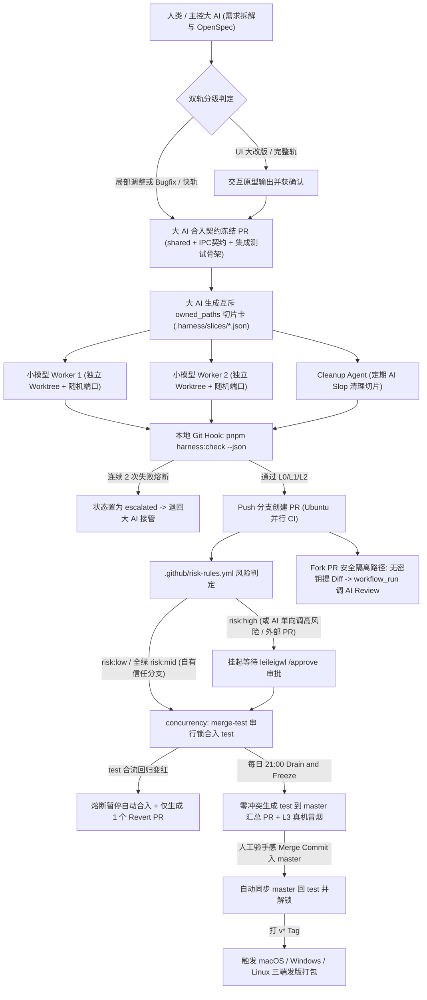

# Design

## Context

详见 [proposal.md](proposal.md) 中的 `## Why` 章节。本设计针对 `vmark` 当前 Monorepo（`pnpm workspace + Turborepo`：[`apps/desktop/`](apps/desktop)、[`packages/shared/`](packages/shared)、[`packages/core/`](packages/core)、[`packages/image-pipeline/`](packages/image-pipeline)、[`packages/adapters/`](packages/adapters)）与 GitHub 仓库（`leileigwl/vmark`，当前为 `private` 且 `master`/`test` 无保护规则），在保证每日高频稳定迭代的前提下，完成从“纯 Markdown 提示词约束”向“代码级确定性 Harness 引擎 + 风险分级自动合并 CI/CD + 可复用多形态模板”的架构升级。

## Goals / Non-Goals

**Goals:**
- 用本地与 CI 共享同一份确定性脚本（`scripts/harness/` + `.harness/*.json`）替代低配/小模型极易遗忘与漂移的纯 Markdown 软约束。
- 根治多 Agent 并行研发在“总合流路口”的跨模块语义冲突，并支持「先改前端测通 → 再加强后端」的接缝契约保护。
- 在切换为 Public 仓库并采用 **AGPL-3.0 + 商业双授权**后，既能面向自有分支安全高效自动合入，又能面向外部 Fork PR 提供同等强度的自动化体检与 Fork 安全隔离 AI Review。
- 形成「标准 Harness 内核 + Profile 适配器」二层结构，支持现有 `desktop-electron` 与后续互联网后端 `web-service`（含容器冒烟、`k6` 压测与 DB Migration 回滚）复用。

**Non-Goals:**
- 不自建重型后端调度平台或 Kubernetes 集群，全部状态机与队列尽量原生存放在 Git 仓库（`.harness/`）与 GitHub 原生能力（Actions `concurrency` / Labels / PR）中。
- 不在 CI 中跑真实第三方外部平台（微信公众号/知乎/百家号/CSDN 等）账号鉴权与线上发草稿测试（L4 始终保留在本地实机显式联调）。
- 本提案实施前不推倒重写现有业务代码，对 7 个历史超标文件采取“棘轮锁死上限 + 增量按域渐进拆分”策略，零停机迁移。

## 整体架构图



## 目录结构与可复用标准边界

为兼顾 `vmark` 标杆落地与未来快速复制到 `ai-study-workbench` 或后续互联网后端项目，仓库划分为**跨项目可复用标准层**与 **`vmark` 专属适配层**：

```text
vmark/
├── .harness/
│   ├── schemas/                         # [标准层] 跨项目通用 JSON Schema（可整目录复用）
│   │   ├── project.schema.json
│   │   ├── state.schema.json
│   │   ├── slice.schema.json
│   │   └── ratchet.schema.json
│   ├── templates/                       # [标准层] 可复用 GitHub Workflows / Hook / web-service 压测规范模板
│   │   ├── workflows/                   # 标准 risk-gate / ai-review / daily-release / slop-audit 模板
│   │   └── web-service-profile.md       # 互联网后端容器冒烟 / DB up-down / k6 压测基线规范
│   ├── project.json                     # [项目适配层] 声明 profile="desktop-electron"、包依赖 DAG、命令映射
│   ├── state.json                       # [运行时状态] 当前活跃 Change 的 Consort 硬状态机快照
│   ├── ratchet.json                     # [项目适配层] 既有 7 个超标文件行数棘轮基线
│   └── slices/                          # [任务切片卡] 当前并行的互斥切片 JSON 文件
├── scripts/
│   └── harness/                         # [标准层] 零外部重依赖 TypeScript/Node CLI（本地与 CI 同源）
│       ├── cli.ts                       # 统一入口：check / transition / risk / slop / slice-verify
│       ├── anti-cheat.ts                # 反作弊 Diff 扫描（.skip/断言数/as any/护栏自改拦截）
│       ├── ratchet.ts                   # 行数棘轮 & 新文件 <=500 行 & 单向依赖拓扑检查
│       ├── slop.ts                      # 5 类 AI Slop 扫描器（联动 knip 与文档死链校验）
│       └── slice-lock.ts                # owned_paths 互斥校验 & 2 次失败熔断计数管理
├── .github/
│   ├── risk-rules.yml                   # [项目适配层] 风险路径规则唯一配置源
│   └── workflows/
│       ├── ci.yml                       # 重构为 ubuntu-latest 并行（check / unit+ipc / e2e / l3-electron）
│       ├── risk-gate.yml                # 信任校验 + 串行 merge-test 合流 + /approve + Freeze 检查
│       ├── ai-review.yml                # Fork 安全隔离两段式 DeepSeek/OpenAI 自动审查
│       ├── daily-release-pr.yml         # 每日 21:00 CST Drain & Freeze 生成 test -> master 汇总 PR
│       ├── auto-revert.yml              # test 回归变红单次 Revert + 熔断保护
│       ├── slop-audit.yml               # 每周 Cron AI Slop 分类体检单
│       └── release.yml                  # 保持仅 v* Tag 触发三端打包（macOS/Windows/Linux）
├── LICENSE                              # GNU AGPL-3.0-only
└── LICENSE-COMMERCIAL.md                # 商业付费双授权条款说明
```

## 核心 Schema 精确结构示例

### 1. `.harness/project.json`（项目画像与 Profile 配置）
```json
{
  "$schema": "./schemas/project.schema.json",
  "projectId": "vmark",
  "profile": "desktop-electron",
  "owner": "leileigwl",
  "licenseMode": "AGPL-3.0-or-commercial",
  "limits": {
    "newFileMaxLines": 500,
    "sliceMaxDiffLines": 300,
    "agentsMdMaxLines": 100,
    "handoffMaxLines": 120,
    "circuitBreakerMaxRetries": 2
  },
  "layerBoundaries": [
    {
      "from": "apps/desktop/src/renderer/**",
      "forbidImportFrom": [
        "apps/desktop/src/main/**",
        "node:fs",
        "node:fs/promises",
        "better-sqlite3",
        "electron"
      ]
    }
  ],
  "commands": {
    "typecheck": "pnpm run typecheck",
    "unit": "pnpm turbo run test",
    "ipcContract": "pnpm --filter @vcat/desktop test:ipc",
    "e2e": "pnpm --filter @vcat/desktop exec playwright test --reporter=list",
    "l3Smoke": "xvfb-run -a pnpm --filter @vcat/desktop test:electron-smoke"
  }
}
```

### 2. `.harness/state.json`（Consort 双轨硬状态机）
```json
{
  "$schema": "./schemas/state.schema.json",
  "changeName": "agent-harness-cicd-redesign",
  "track": "fast",
  "phase": "SPEC",
  "prototypeApproved": false,
  "contractFrozen": false,
  "activeFreezeLock": false,
  "gates": {
    "specValidated": false,
    "frontendTddPassed": false,
    "ipcContractPassed": false,
    "backendTddPassed": false
  },
  "updatedAt": "2026-11-19T14:50:00+08:00"
}
```

### 3. `.harness/slices/<id>.json`（互斥并行切片卡）
```json
{
  "$schema": "./schemas/slice.schema.json",
  "sliceId": "decouple-main-ipc-auth",
  "changeName": "agent-harness-cicd-redesign",
  "assigneeTier": "small-model",
  "worktreeBranch": "slice/decouple-main-ipc-auth",
  "status": "in_progress",
  "retryCount": 0,
  "maxRetries": 2,
  "maxDiffLines": 300,
  "ownedPaths": [
    "apps/desktop/src/main/ipc/authHandlers.ts",
    "apps/desktop/src/main/ipc/authHandlers.test.ts"
  ],
  "forbiddenPaths": [
    ".harness/**",
    ".github/**",
    "scripts/harness/**",
    "packages/shared/**"
  ],
  "requiredChecks": ["L0", "L1"],
  "lastFailureSummary": null
}
```

### 4. `.harness/ratchet.json`（历史超标文件行数棘轮基线）
```json
{
  "$schema": "./schemas/ratchet.schema.json",
  "defaultNewFileMaxLines": 500,
  "files": {
    "apps/desktop/src/renderer/src/App.tsx": { "maxLines": 1393, "targetLines": 500 },
    "apps/desktop/src/main/index.ts": { "maxLines": 1303, "targetLines": 500 },
    "apps/desktop/src/renderer/src/components/VditorEditor.tsx": { "maxLines": 1157, "targetLines": 500 },
    "apps/desktop/src/renderer/src/editor/vditorKeyboard.ts": { "maxLines": 991, "targetLines": 500 },
    "apps/desktop/src/main/publishHandlers.ts": { "maxLines": 871, "targetLines": 500 },
    "apps/desktop/src/renderer/src/components/Sidebar.tsx": { "maxLines": 867, "targetLines": 500 },
    "apps/desktop/src/renderer/src/components/SettingsView.tsx": { "maxLines": 637, "targetLines": 500 }
  }
}
```

### 5. `.github/risk-rules.yml`（风险分级唯一配置源）
```yaml
version: 1
max_auto_merge_lines: 300
tiers:
  high:
    paths:
      - "packages/core/**"
      - "packages/adapters/**"
      - "packages/image-pipeline/**"
      - "packages/shared/**"
      - "apps/desktop/src/main/**"
      - "apps/desktop/src/preload/**"
      - ".github/**"
      - ".harness/**"
      - "scripts/harness/**"
      - "package.json"
      - "pnpm-workspace.yaml"
      - "pnpm-lock.yaml"
      - "LICENSE*"
      - "**/*secret*"
      - "**/*token*"
      - "**/*auth*"
    require_approve_comment: "/approve"
    allow_auto_merge: false
    run_l3_smoke: true
  mid:
    paths:
      - "apps/desktop/src/renderer/**"
      - "apps/desktop/scripts/**"
    allow_auto_merge: true
    allow_ai_escalation: true
    run_e2e: true
  low:
    paths:
      - "docs/**"
      - "openspec/**"
      - "*.md"
      - "**/*.test.ts"
      - "apps/desktop/tests/**"
    allow_auto_merge: true
    skip_e2e_when_docs_only: true
```

## `vmark` 巨型枢纽文件渐进式解耦方案

为彻底消除并行切片在 `main/index.ts`（1303 行）与 `App.tsx`（1393 行）处的合流磁铁效应，Phase 3 将引入**“只增插件、不改总线”**的注册表架构，并每拆一块同步下调 `.harness/ratchet.json` 基线：

1. **主进程拆分（`apps/desktop/src/main/`）**：
   - 将当前集中在 `main/index.ts`（第 340–894 行前后约 30 个 `ipcMain.handle`）按业务域拆至：
     - `src/main/ipc/registry.ts`（总装配表，≤80 行）
     - `src/main/ipc/workspaceHandlers.ts`（工作区与目录 CRUD）
     - `src/main/ipc/articleHandlers.ts`（文章读写、搜索、重命名与导入导出）
     - `src/main/ipc/imageAndConfigHandlers.ts`（图床与启动配置）
     - `src/main/ipc/platformAuthHandlers.ts`（沙箱 Partition 登录、退出与心跳过期检测）
     - `src/main/windowLifecycle.ts`（窗口创建、菜单、全屏状态同步与协议拦截）
   - 此后新增 IPC 能力时，小模型仅需修改对应子域文件 + `packages/shared/src/ipcContract.ts`，不再撞入 `main/index.ts`。
2. **渲染层拆分（`apps/desktop/src/renderer/src/`）**：
   - 将 `App.tsx` 中混合的状态逻辑拆至领域 Hooks（`src/renderer/src/features/workspace/useWorkspaceState.ts`、`features/publish/usePublishDrawer.ts`、`features/auth/usePlatformAuthToast.ts`、`features/theme/useBloomTheme.ts`），`App.tsx` 收敛为纯布局壳（目标 ≤300 行）。

## 大小模型路由准则与 2 次熔断机制

- **何时必须使用大 AI（单线程统筹）**：
  1. 需求梳理、交互原型方案评估、OpenSpec（`proposal` / `specs` / `design` / `tasks`）起草与更新；
  2. **契约冻结阶段**：编写 `packages/shared` 接口契约、`ipcContract` 与跨模块集成测试骨架，生成互斥切片卡；
  3. 涉及 `packages/core` / `adapters` / `image-pipeline` / `main` / `preload` / `.github` / `.harness` 的 `risk:high` 修改；
  4. 合流路口语义冲突裁决与重构枢纽文件；
  5. 接收小模型 `status: "escalated"` 熔断后的根因重构或二次拆细。
- **何时直接派发小模型多路并发开工**：
  1. `.harness/state.json` 已达到 `CONTRACT_FROZEN`；
  2. 每个小模型持有独立的 `.harness/slices/<id>.json`（`ownedPaths` 交集为空、`maxDiffLines <= 300`、非 `risk:high` 路径）；
  3. 在各自独立 `git worktree` 中同时实现局部 UI 组件、主题 CSS、单模块工具函数、单测/Playwright E2E 补充、文档修补及 weekly AI Slop 清理切片。
- **2 次熔断规则**：`pnpm harness:slice-verify --slice <id>` 每次拦截失败都会回写 `retryCount += 1` 与极简 `lastFailureSummary`；若 `retryCount >= 2`，自动写入 `status: "escalated"`，Git pre-commit/CLI 直接锁定该分支拒绝第 3 次盲改，必须由大 AI 介入排查或重新拆分。

## 10 大补充盲区与工程防线总表

| 编号 | 识别盲区 | 生产/开源风险 | 确定性工程防线 |
| :--- | :--- | :--- | :--- |
| **01** | **Public 前历史敏感残留** | 仓库从 Private 切 Public 后，`git log` 历史中若含调试用 Cookie（`BDUSS`/`SESSDATA`）、API Key 或本机隐私路径会被秒爬 | Phase 0 强制执行 `gitleaks` / `git log -S` 全历史正则扫描与高危提交重写清洗，确认零泄露后再执行 `gh repo edit --visibility public` |
| **02** | **Fork PR 密钥泄露（Pwn-Request）** | 用 `pull_request_target` 直接跑 Fork PR 的 `pnpm test` 或脚本，恶意 PR 修改 `package.json` 可窃取 `DEEPSEEK_API_KEY` | AI Review 拆为两段：`pull_request`（无 Secrets 权限）跑单测并仅导出纯文本 `.diff` Artifact；`workflow_run`（不检出 Fork 代码）仅读取 Diff 调 DeepSeek API 发评注 |
| **03** | **小模型“作弊过测试”** | 小模型为拿绿灯会给报错测试加 `.skip`、删除 `assert`、`as any` 绕过 TS，或篡改 `.github/` 降级风险规则 | `anti-cheat.ts` 机械比对 base..HEAD diff：禁止新增 skip/only、禁止无声明削减断言数、禁止未豁免 `as any`/`@ts-ignore`、禁止低风险 PR 修改护栏文件 |
| **04** | **巨型文件与枢纽磁铁扩散** | 7 个历史大文件若不封顶，小模型仍会不断往里塞代码导致合并冲突率居高不下 | `.harness/ratchet.json` 锁死当前上限“只减不增”，新文件严格 ≤500 行；每次拆分成功单向下降基线，未授权增量即报错 |
| **05** | **并发 Worktree 端口与目录踩踏** | 多个小模型并发跑 Playwright，写死 `vite preview --port 4173` 与相同临时目录会导致随机互相挤占失败 | 改造 `playwright.config.ts` 与测试夹具：未传 `CI` 时自动分配空闲端口（`get-port`）+ `fs.mkdtempSync` 独立 userData/SQLite 路径 |
| **06** | **每日汇总 PR 与 Squash 分叉冲突** | 日常 PR 用 `--squash` 入 `test`，若 `test → master` 再 Squash 合并，翌日 `test` 与 `master` 祖先分叉必冲突 | 每日 21:00 执行 **Drain & Freeze**（先排空 `merge-test` 并冻结入队），生成 `test → master` 后**必须用 Merge Commit** 合入 `master`，随后立即 fast-forward/merge 回 `test` 并解冻 |
| **07** | **Auto-Revert 雪崩连环回滚** | `test` 变红若无条件触发自动回滚且没加锁，回滚提交再次失败会形成无限 Revert 循环 | `auto-revert.yml` 触发后先打 `circuit:paused` 熔断标签暂停所有自动合入，且检查当前不存在 open Revert PR 后，才生成**唯一 1 个**回滚 PR 交人工介入 |
| **08** | **冗长日志撑爆小模型上下文** | Turbo/Playwright 报错往往输出上千行堆栈，低配小模型读后丢失焦点开始乱改 | `pnpm harness:check --json` 将全部机械错误压缩为 `<=20` 条结构化四元组 `{ file, line, rule_id, fix_hint }`，控制报错体积在 2KB 内 |
| **09** | **未来互联网后端无压测基准** | 后续后端产品不能仅靠桌面端 Electron 测试模板，缺压测和不可逆 SQL 迁移会炸库 | 标准层内嵌 `web-service-profile.md`：固化容器 DB/Redis 集成、Migration `up -> seed -> down -> up` 必测、`k6` P95/错误率 `<0.1%`/内存斜率门禁规范 |
| **10** | **AGPL-3.0 + 商业双授权法律瑕疵** | 切 Public 后未配标准许可证，或外部贡献者 PR 未确认贡献授权会导致后续商业授权争议 | 根目录落盘官方 `AGPL-3.0-only` `LICENSE` + `LICENSE-COMMERCIAL.md`；外部 PR 自动评论提示遵循本仓双授权 CLA/DCO；CI 增加第三方依赖协议兼容审计 |

## Decisions

1. **决策 1：采用原生 TypeScript（Node `--experimental-strip-types` / `node` 直接运行）编写 `scripts/harness/`**
   - *Rationale*：`vmark` 团队已全栈使用 TypeScript，且当前环境为 pnpm + Node 22/24，无需引入 Python 或 Go 等第二套运行时，本地 Hook 与 Ubuntu CI 零环境差异。
   - *Alternative considered*：使用 shell 脚本拼 `grep/jq`（跨平台维护脆弱且难做 AST/TypeScript 导入拓扑分析）。
2. **决策 2：采用 `concurrency: merge-test` + 合前同步重跑代替 GitHub Merge Queue**
   - *Rationale*：GitHub 官方 Merge Queue 对私有仓库免费账号受限，而 `concurrency` 互斥锁 + 工作流内检查 `behind` 并合前自动合并最新 `test` 在 Public/Private 仓均 100% 免费稳定可用。
   - *Alternative considered*：直接开启官方 Merge Queue（在未切 Public 或个人账号方案下不可用或策略受限）。
3. **决策 3：选用 `AGPL-3.0-only` + `LICENSE-COMMERCIAL.md` 替代自定义 Noncommercial**
   - *Rationale*：AGPL-3.0 是 GitHub 官方识别的强 Copyleft OSI 协议，既能保护桌面端分发也能约束未来互联网 SaaS 后端必须开源或购买商业授权，同时生态工具（如开源依赖审计）兼容度最高。
   - *Alternative considered*：PolyForm Noncommercial（非 OSI 开源标准，部分企业与开源生态工具链支持较弱）。
4. **决策 4：将现有 `openspec/changes/init-cat-publisher` 补齐同步后归档，不直接粗暴删除**
   - *Rationale*：`init-cat-publisher`（`0/13`）记录了 `vmark` 初版编辑、图床与多平台分发基线契约，补齐核对已实现部分迁移至 `openspec/specs/` 后正式归档，使 `openspec/specs/` 成为完整业务能力账本。

## Risks / Trade-offs

- **[Risk] 行数棘轮与反作弊门禁初期可能对快速 Hack 修复产生轻微摩擦** → **Mitigation**: 通过 `@harness-exempt: <reason> (expires: YYYY-MM-DD)` 提供可审计临时豁免标记，并在每周 AI Slop 体检单中自动追踪过期豁免。
- **[Risk] `ubuntu-latest` 下运行真 Electron L3 冒烟需要 `xvfb-run` 与图形共享库（`libnss3`/`libgtk-3`）依赖，存在偶发启动抖动** → **Mitigation**: 将 L3 Electron 冒烟限定在 `risk:high`、`test` 合流后及每日汇总窗口运行（不阻塞低/中风险日常 PR 极速绿灯），配置 1 次自动重试与日志截图 Artifact 留存。
- **[Risk] 切 Public 前全历史重写若清理出敏感提交，会导致本地与远端 Commit SHA 变化** → **Mitigation**: 切 Public 前在清理阶段完成历史扫描与强推对齐，保留完整只读备份分支确认无误后，再统一清理备份并切换仓库可见性。

## Migration Plan

按 5 个渐进式可回滚 Phase 实施（具体可执行项见 `tasks.md`）：
1. **Phase 0（公开与 SSOT 前置清场）**：先在本地执行历史敏感扫描，补全双授权许可与精简 `AGENTS.md`，归档重叠设计与历史 `init-cat-publisher` 并补全 `openspec/specs/`，经用户最终确认后切换 `leileigwl/vmark` 为 Public。
2. **Phase 1（本地代码级 Harness 上线）**：落地 `.harness/` Schema 与 `scripts/harness/` CLI，接入本地 Git Hook 并完成 0 误报自测，此后即可安全引入小模型并发执行低/中风险切片。
3. **Phase 2（GitHub 治理与分级 CI/CD 上线）**：先上线 `ubuntu-latest` 并行 CI 与 `.github/risk-rules.yml` 试跑打标，再逐步打开自动合入、每日 Drain & Freeze、`auto-revert` 与安全隔离 `ai-review`。
4. **Phase 3（测试金字塔加固与枢纽文件拆分）**：落地 IPC 契约测试、Playwright 动态端口隔离、L3 `xvfb-run` 冒烟测试，并分切片将 `main/index.ts` 与 `App.tsx` 拆解至 500 行以下。
5. **Phase 4（每周熵减流水线与跨项目模板沉淀）**：激活每周 Cron Slop 巡检并沉淀 `web-service` 后端规范模板包供新项目复制复用。
