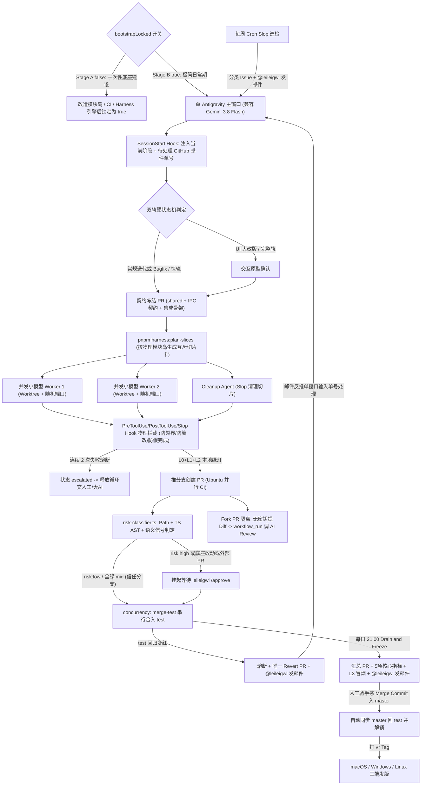

# Design

## Context

详见 [proposal.md](proposal.md) 中的 `## Why` 章节。本设计针对 `vmark` 当前 Monorepo（`pnpm workspace + Turborepo`：[`apps/desktop/`](apps/desktop)、[`packages/shared/`](packages/shared)、[`packages/core/`](packages/core)、[`packages/image-pipeline/`](packages/image-pipeline)、[`packages/adapters/`](packages/adapters)）与 GitHub 仓库（`leileigwl/vmark`，当前为 `private` 且 `master`/`test` 无保护规则），解决以下三项核心工程矛盾：
1. 即使主控窗口直接运行 Gemini 3.8 Flash 等小模型并高速并发拆路线，也绝不跑偏或假完成；
2. 当前 Stage A 允许一次性重构底座与模块岛拆分，但完成后通过 `bootstrapLocked: true` 硬锁定进入 Stage B 极简日常；
3. 将全部规范、AST 风险检测与 `web-service` 后端冒烟/压测模板封装为跨项目可执行 Harness Kit（`init-project`），实现零散文迁移复用。

## Goals / Non-Goals

**Goals:**
- 用原生 Agent Hook（`.agents/hooks.json` / `.claude/settings.json`）+ Git Hook + GitHub Actions 三端同源执行 `scripts/harness/`，彻底摆脱纯 Markdown 软约束对小模型的失灵风险。
- 通过 `bootstrapLocked` 两阶段开关，先在 Stage A 把 `vmark` 底座与 7 大超标文件彻底拆解为垂直物理模块岛（Barrel-Only + 无环 DAG），随后锁死框架层，日常只在业务岛内高并发敏捷迭代。
- 用「Path + TypeScript AST + Diff 语义信号」三层确定性计算取代主观/纯文件名的风险分级。
- 用每日 21:00 CST `test → master` 5 指标汇总邮件、每周 Cron Slop 体检 Issue 邮件与异常 Auto-Revert 邮件，实现“只开 1 个 Antigravity 窗口 + 看 GitHub 邮件”的异步反推工作流。
- 通过 `init-project` 与可执行 Profile 资产，将体系直接复制到后续桌面或互联网后端项目。

**Non-Goals:**
- 不自建重型后端调度平台或 Kubernetes 集群，全部状态机与队列原生存放在 Git 仓库（`.harness/`）与 GitHub 原生能力中。
- 不在 CI 中跑真实第三方外部平台账号鉴权与线上发草稿测试（L4 始终保留在本地实机显式联调）。
- 不依赖单一模型厂商（所有护栏通过标准 JSON stdin/stdout Hook 或 POSIX CLI 运行，兼容 Gemini 3.8 Flash、Claude、Codex 及本地/云端 OpenAI 兼容小模型）。

## 整体架构图



## 目录结构与可执行跨项目工具包边界

```text
vmark/
├── .agents/
│   ├── hooks.json                       # [原生生命周期硬锁] SessionStart / PreToolUse / PostToolUse / Stop
│   ├── workflows/                       # OpenSpec 既有工作流
│   └── skills/
├── .claude/
│   └── settings.json                    # [多 Agent 兼容] 映射至同一份 hook-adapter.ts
├── .githooks/                           # [本地 Git 防线] pre-commit / pre-push 调用 harness:check
├── .harness/
│   ├── schemas/                         # [标准层] project / state / slice / ratchet JSON Schema
│   ├── profiles/                        # [标准层-可执行 Profile 套件，替代纯 MD]
│   │   ├── desktop-electron.json        # Electron 桌面端命令/边界/L3 冒烟契约
│   │   ├── web-service.json             # 互联网后端容器/迁移/压测契约
│   │   └── web-service/
│   │       ├── compose.smoke.yml        # 容器化 DB + Redis + App 集成编排模板
│   │       ├── migration-check.sh       # up -> seed -> down -> up 可逆性校验脚本
│   │       ├── k6-smoke.js              # 可执行 k6 压测脚本（P95/错误率/内存门禁）
│   │       └── thresholds.json          # P95/P99 与错误率 <0.1% 阈值配置
│   ├── project.json                     # [项目适配层] bootstrapLocked、moduleIslands、notifyUser
│   ├── state.json                       # [运行时状态] Consort 双轨硬状态机快照
│   ├── ratchet.json                     # [项目适配层] 既有 7 个超标文件行数棘轮基线
│   └── slices/                          # [任务切片卡] 互斥切片 JSON 文件
├── scripts/
│   └── harness/                         # [标准层] 零重依赖 TypeScript/Node 引擎
│       ├── cli.ts                       # 入口：check/transition/risk/slop/plan-slices/unlock-bootstrap
│       ├── hook-adapter.ts              # 统一 stdin/stdout 适配 Antigravity / Claude / Git Hook
│       ├── risk-classifier.ts           # Path + TS AST + Diff 语义三层风险判定
│       ├── arch-graph.ts                # TS Compiler API 物理模块岛 Barrel-Only & 无环 DAG 守卫
│       ├── anti-cheat.ts                # 反作弊 Diff 扫描（.skip/断言数/as any/护栏锁定检查）
│       ├── ratchet.ts                   # 行数棘轮 & 新文件 <=500 行检查
│       ├── slop.ts                      # 5 类 AI Slop 扫描器（联动 knip 与死链检查）
│       ├── slice-lock.ts                # ownedPaths 互斥校验 & 2 次失败熔断计数管理
│       └── init-project.ts              # 可执行脚手架：一键复制标准层并按 Profile 初始化新项目
├── docs/
│   ├── PRODUCT.md                       # [宪法层] 产品定位与边界
│   ├── ARCHITECTURE.md                  # [宪法层] 单向依赖、模块岛与技术约束
│   ├── OPERATOR_PLAYBOOK.md             # [操作手册] 一页式单窗口极简日常规范
│   └── session-handoff.md               # [快照层] ≤120 行覆盖式交接快照
├── AGENTS.md                            # [宪法入口] ≤100 行极简开机引导
├── LICENSE                              # GNU AGPL-3.0-only
├── LICENSE-COMMERCIAL.md                # 商业付费双授权条款说明
└── .github/
    ├── risk-rules.yml                   # 风险路径基准配置
    ├── PULL_REQUEST_TEMPLATE.md         # 外部贡献者 CLA/DCO 与自检清单
    └── workflows/                       # ci / risk-gate / ai-review / daily-release-pr / auto-revert / slop-audit / release
```

## 原生生命周期 Hook 契约（让 3.8 Flash 等小模型物理上跑不偏）

为严格匹配 Antigravity Customization 规范（`.agents/hooks.json`，camelCase stdin/stdout JSON），各事件执行确定性逻辑如下：

```json
{
  "harness-orchestrator-guard": {
    "enabled": true,
    "SessionStart": [
      {
        "type": "command",
        "command": "node --experimental-strip-types scripts/harness/hook-adapter.ts --event SessionStart",
        "timeout": 10
      }
    ],
    "PreToolUse": [
      {
        "matcher": "edit_file|write_file|run_command",
        "hooks": [
          {
            "type": "command",
            "command": "node --experimental-strip-types scripts/harness/hook-adapter.ts --event PreToolUse",
            "timeout": 10
          }
        ]
      }
    ],
    "PostToolUse": [
      {
        "matcher": "edit_file|write_file",
        "hooks": [
          {
            "type": "command",
            "command": "node --experimental-strip-types scripts/harness/hook-adapter.ts --event PostToolUse",
            "timeout": 15
          }
        ]
      }
    ],
    "Stop": [
      {
        "type": "command",
        "command": "node --experimental-strip-types scripts/harness/hook-adapter.ts --event Stop",
        "timeout": 30
      }
    ]
  }
}
```

`hook-adapter.ts` 在四个阶段的行为契约：
1. **`SessionStart`**：输出 `injectSteps`（`systemMessage.systemMessage`），用 ≤300 Token 注入当前 `bootstrapLocked`、`state.json` 阶段、激活中的切片 `ownedPaths`、以及 `gh` 拉取的当前 `@leileigwl` 待处理 Issue/汇总 PR。
2. **`PreToolUse`**：解析 `toolCall.name` 与 `toolCall.args`：
   - 对 `edit_file` / `write_file`：检查目标路径是否在 `.harness/project.json` 锁定底座内（若 `bootstrapLocked === true` 直接返回 `{"decision":"deny","reason":"底座已锁定，仅允许 pnpm harness:unlock-bootstrap 后修改框架"}`）；若处于切片模式但目标不在 `ownedPaths` 或命中 `forbiddenPaths`，直接返回 `deny`；若 `state.json` 尚未达 `CONTRACT_FROZEN` 且改动源码而非 OpenSpec/契约文件，直接返回 `deny`。
   - 对 `run_command`：拦截绕过 `pnpm` 的 `npm`/`yarn`、拦截直接 `git push --force`、拦截手工 `--no-verify` 跳过 Hook 等高危命令（返回 `deny` 或 `ask`）。
3. **`PostToolUse`**：增量对刚写入的单个文件运行行数棘轮、跨模块岛 AST 导入及反作弊检查，若有违例即刻落盘至 `.harness/.last-violations.json` 供 `Stop` 读取。
4. **`Stop`**：读取 `continuationActive` 与 `terminationReason`：若切片处于 `status: "escalated"`（连续 2 次熔断），允许立即终止以便人类或大 AI 接管；若未过 `pnpm harness:check --json` 且 `!continuationActive`，返回 `{"decision":"continue","reason":"<精简JSON四元组 fix_hint>"}` 阻止小模型假完成。同时在 `.claude/settings.json` 挂载同等命令，实现多 Agent 工具链零差异护栏。

## Path + TypeScript AST + 语义三层风险与物理模块岛架构

### 1. `scripts/harness/risk-classifier.ts`（去纯 MD / 去纯路径欺骗）
使用仓库自带 `typescript` 依赖的 `ts.createSourceFile` 进行轻量化 AST 解析（耗时 `<1s`），与 `.github/risk-rules.yml` 组合输出最终风险：
- **第 1 层（路径与规模）**：`.github/risk-rules.yml` 路径集 + 改动行数 > 300 行。
- **第 2 层（TypeScript AST 结构信号）**：解析每个改动的 `.ts`/`.tsx` 文件旧版与新版 AST：
  - 若模块岛 Barrel `index.ts` 或 `packages/shared` 中的 `export type` / `export interface` / `export function` 参数与返回值签名发生变化，立即判定 `risk:high`；
  - 若文件 `importDeclaration` 跨越了 `project.json` 声明的层边界或引用非 Barrel 内部文件，直接报错并升至 `risk:high`。
- **第 3 层（Diff 语义信号）**：扫描新增 `+` 行中是否包含敏感运行原语（`ipcMain`、`ipcRenderer`、`safeStorage`、`child_process`、`eval(`、`new Function`、SQL DDL/DML 模板、`process.env`、`Cookie` 写入），一旦命中即自动标记为 `risk:high` 并附精确行号理由。

### 2. `scripts/harness/arch-graph.ts` & `vmark` 物理模块岛拆分
为使多个 3.8 Flash Worker 并发拆路线开发时物理上零冲突，强制实施**垂直物理模块岛（Vertical Feature Islands）**：
- **主进程按域模块岛**（`apps/desktop/src/main/ipc/<domain>/index.ts`）：拆分为 `workspace`、`article`、`image-config`、`platform-auth`、`publish` 与 `windowLifecycle`，由极薄的总装表 `src/main/ipc/registry.ts`（≤80 行）汇入，消灭 1303 行 `main/index.ts` 冲突点。
- **渲染层按域模块岛**（`apps/desktop/src/renderer/src/features/<domain>/index.ts`）：拆分为 `workspace-tree`、`editor-ir`、`publish-drawer`、`auth-settings`、`theme-bloom`，仅暴露公共 Hooks/组件于 `index.ts`，禁止岛与岛之间 `import` 内部子文件，`App.tsx`（现 1393 行）收敛为 ≤300 行纯布局壳。
- **适配器岛**（`packages/adapters/src/platforms/<platform>.ts`）：一平台一文件并自动向 `registry.ts` 注册，并发新增平台适配器零互相踩踏。

## 核心 Schema 精确结构示例

### 1. `.harness/project.json`（含 `bootstrapLocked`、物理模块岛与通知配置）
```json
{
  "$schema": "./schemas/project.schema.json",
  "projectId": "vmark",
  "profile": "desktop-electron",
  "owner": "leileigwl",
  "githubNotifyUser": "leileigwl",
  "bootstrapLocked": false,
  "bootstrapLockProtectedPaths": [
    ".harness/**",
    "scripts/harness/**",
    ".agents/hooks.json",
    ".claude/settings.json",
    ".githooks/**",
    ".github/**",
    "AGENTS.md",
    "LICENSE*"
  ],
  "licenseMode": "AGPL-3.0-or-commercial",
  "limits": {
    "newFileMaxLines": 500,
    "sliceMaxDiffLines": 300,
    "agentsMdMaxLines": 100,
    "handoffMaxLines": 120,
    "circuitBreakerMaxRetries": 2
  },
  "moduleIslands": {
    "rendererRoot": "apps/desktop/src/renderer/src/features",
    "mainIpcRoot": "apps/desktop/src/main/ipc",
    "barrelFile": "index.ts",
    "forbidCrossIslandDeepImport": true,
    "forbidCycles": true
  },
  "layerBoundaries": [
    {
      "from": "apps/desktop/src/renderer/**",
      "forbidImportFrom": [
        "apps/desktop/src/main/**",
        "node:fs",
        "node:fs/promises",
        "better-sqlite3",
        "electron"
      ]
    }
  ],
  "commands": {
    "typecheck": "pnpm run typecheck",
    "unit": "pnpm turbo run test",
    "ipcContract": "pnpm --filter @vcat/desktop test:ipc",
    "e2e": "pnpm --filter @vcat/desktop exec playwright test --reporter=list",
    "l3Smoke": "xvfb-run -a pnpm --filter @vcat/desktop test:electron-smoke"
  }
}
```

### 2. `.harness/state.json`（Consort 双轨硬状态机）
```json
{
  "$schema": "./schemas/state.schema.json",
  "changeName": "agent-harness-cicd-redesign",
  "track": "fast",
  "phase": "SPEC",
  "prototypeApproved": false,
  "contractFrozen": false,
  "activeFreezeLock": false,
  "gates": {
    "specValidated": false,
    "frontendTddPassed": false,
    "ipcContractPassed": false,
    "backendTddPassed": false
  },
  "updatedAt": "2026-11-19T15:00:00+08:00"
}
```

### 3. `.harness/slices/<id>.json`（互斥并行切片卡）
```json
{
  "$schema": "./schemas/slice.schema.json",
  "sliceId": "island-auth-settings",
  "changeName": "agent-harness-cicd-redesign",
  "assigneeTier": "small-model",
  "worktreeBranch": "slice/island-auth-settings",
  "status": "in_progress",
  "retryCount": 0,
  "maxRetries": 2,
  "maxDiffLines": 300,
  "ownedPaths": [
    "apps/desktop/src/renderer/src/features/auth-settings/**",
    "apps/desktop/tests/settings.spec.ts"
  ],
  "forbiddenPaths": [
    ".harness/**",
    ".github/**",
    "scripts/harness/**",
    "packages/shared/**"
  ],
  "requiredChecks": ["L0", "L1", "L2"],
  "lastFailureSummary": null
}
```

### 4. `.harness/ratchet.json`（历史超标文件行数棘轮基线）
```json
{
  "$schema": "./schemas/ratchet.schema.json",
  "defaultNewFileMaxLines": 500,
  "files": {
    "apps/desktop/src/renderer/src/App.tsx": { "maxLines": 1393, "targetLines": 500 },
    "apps/desktop/src/main/index.ts": { "maxLines": 1303, "targetLines": 500 },
    "apps/desktop/src/renderer/src/components/VditorEditor.tsx": { "maxLines": 1157, "targetLines": 500 },
    "apps/desktop/src/renderer/src/editor/vditorKeyboard.ts": { "maxLines": 991, "targetLines": 500 },
    "apps/desktop/src/main/publishHandlers.ts": { "maxLines": 871, "targetLines": 500 },
    "apps/desktop/src/renderer/src/components/Sidebar.tsx": { "maxLines": 867, "targetLines": 500 },
    "apps/desktop/src/renderer/src/components/SettingsView.tsx": { "maxLines": 637, "targetLines": 500 }
  }
}
```

### 5. `.github/risk-rules.yml`（路径与阈值配置，配合 AST/语义三层使用）
```yaml
version: 1
max_auto_merge_lines: 300
tiers:
  high:
    paths:
      - "packages/core/**"
      - "packages/adapters/**"
      - "packages/image-pipeline/**"
      - "packages/shared/**"
      - "apps/desktop/src/main/**"
      - "apps/desktop/src/preload/**"
      - ".github/**"
      - ".harness/**"
      - ".agents/**"
      - ".claude/**"
      - ".githooks/**"
      - "scripts/harness/**"
      - "package.json"
      - "pnpm-workspace.yaml"
      - "pnpm-lock.yaml"
      - "LICENSE*"
      - "**/*secret*"
      - "**/*token*"
      - "**/*auth*"
    require_approve_comment: "/approve"
    allow_auto_merge: false
    run_l3_smoke: true
  mid:
    paths:
      - "apps/desktop/src/renderer/**"
      - "apps/desktop/scripts/**"
    allow_auto_merge: true
    allow_ai_escalation: true
    run_e2e: true
  low:
    paths:
      - "docs/**"
      - "openspec/**"
      - "*.md"
      - "**/*.test.ts"
      - "apps/desktop/tests/**"
    allow_auto_merge: true
    skip_e2e_when_docs_only: true
```

## 单窗口极简日常操作蓝图（Operator Playbook Blueprint）

当 Stage A 执行完毕并将 `.harness/project.json` 锁定为 `"bootstrapLocked": true` 后，全部日常工作流固化至 `docs/OPERATOR_PLAYBOOK.md`：

1. **单窗口开机交互流（无论主控是否切到 Gemini 3.8 Flash）**：
   - **Step 1**：只开 1 个 Antigravity 窗口，进入会话时 `SessionStart` Hook 自动呈报当前状态、锁状态与待处理的 GitHub 邮件单号；
   - **Step 2**：直接提需求（如 `需求：给发布抽屉增加定时草稿提示`）或处理邮件单号（如 `处理 Slop Issue #12` / `修一下今天汇总 PR 的冲突`）；
   - **Step 3**：模型自动先走 OpenSpec 与契约校验 → 调用 `pnpm harness:plan-slices` 生成互不重叠的 `ownedPaths` 切片 → 派发多只小模型在独立 Worktree 并行 TDD；每步写文件均被 `PreToolUse`/`PostToolUse`/`Stop` Hook 硬锁护航，全程无需你盯细节。
2. **每天仅需做的 2 个朴素动作 + GitHub 邮件反推**：
   - **动作 1（白天零打扰提需求）**：提需求让其并发做完推 PR；低/中风险 PR CI 绿灯后自动 Squash 入 `test`；仅当你收到 GitHub 邮件提示 `risk:high 等待 /approve` 时点进去审查或回复 `/approve`。
   - **动作 2（每晚 21:00 后收每日汇总邮件并上手测一次）**：打开系统自动建好的当日 `test → master` 汇总 PR，先瞄一眼正文自动生成的 **每日 5 大核心指标**，本地拉取分支上手实测 3 分钟确认体验；没问题直接点 Merge Commit 合入 `master`（CI 自动同步回 `test` 并解锁下一天）。
3. **每日必看的 5 个量化健康指标**：
   - **自动合入率**（低/中风险免审直接入 `test` 占比，目标 `≥ 70%`）
   - **小模型熔断率**（`retryCount >= 2` 触发 `escalated` 比例，异常飙高说明需要升级模型或细化切片）
   - **合流回归与 Auto-Revert 次数**（`test` 变红次数，衡量“先单测绿合流后集成炸”的接缝质量）
   - **棘轮与 5 类 AI Slop 净变化量**（新增死代码/7 大文件行数增减，必须长期呈下降趋势）
   - **Ubuntu CI 平均耗时**（验证并发缓存与路径分流效率）
4. **全仓文件唯一归属地图**（去重复）：
   - 长期规则与命令：`AGENTS.md`（≤100行）；产品与架构宪法：`docs/PRODUCT.md` & `docs/ARCHITECTURE.md`；每日上手速查：`docs/OPERATOR_PLAYBOOK.md`；最新进度快照：`docs/session-handoff.md`（≤120行覆盖写）；一切改动需求与契约：`openspec/changes/<slug>/`（完结归档进 `openspec/specs/`）；机械规则与状态机：`.harness/*.json` & `.github/risk-rules.yml`。

## 10 大补充盲区与工程防线总表

| 编号 | 识别盲区 | 生产/开源风险 | 确定性工程防线 |
| :--- | :--- | :--- | :--- |
| **01** | **Public 前历史敏感残留** | 仓库切 Public 后，`git log` 历史若含平台 Cookie（`BDUSS`/`SESSDATA`）或密钥会被秒爬 | Phase 0 执行 `gitleaks` / `git log -S` 全历史扫描清洗，确认零泄露后再改可见性 |
| **02** | **Fork PR 密钥泄露（Pwn-Request）** | `pull_request_target` 直接跑 Fork 代码会泄露 `DEEPSEEK_API_KEY` | 两段隔离：`pull_request`（无 Secrets）产 Diff Artifact；`workflow_run`（不执行 Fork 代码）读 Diff 调 API |
| **03** | **小模型“作弊与假完成”** | 3.8 Flash 等小模型可能偷加 `.skip`、删断言、`as any`，或未跑完测试直接结束对话 | `anti-cheat.ts` + 原生 `PreToolUse`/`PostToolUse`/`Stop` Hook 硬拒绝并强迫修至绿灯 |
| **04** | **3.8 Flash 日常顺手改底座** | 日常需求里模型容易“顺手优化”重构 CI 或改 `.harness` 规则放宽约束 | `.harness/project.json` 设置 `bootstrapLocked: true`，日常态 Hook 与 CI 双层拒绝改动底座 |
| **05** | **并发 Worktree 端口与目录踩踏** | 多并发跑 Playwright 抢占固定 4173 端口与共享 userData 目录 | 动态端口分配 + `fs.mkdtempSync` 独立临时目录 |
| **06** | **每日汇总 PR 与 Squash 分叉冲突** | 日常 PR Squash 入 `test`，若 `test → master` 再 Squash 必然翌日冲突 | 21:00 CST **Drain & Freeze** + **Merge Commit** 合入 `master` 后立即同步回 `test` 并解锁 |
| **07** | **Auto-Revert 雪崩连环回滚** | `test` 变红无限制自动 Revert 会引发连环回滚死循环 | 熔断标 `circuit:paused` + 去重校验仅生唯一 1 个 Revert PR 并 `@leileigwl` |
| **08** | **冗长日志撑爆小模型上下文** | 千行堆栈让小模型失去焦点胡乱改代码 | `pnpm harness:check --json` 压缩为 ≤20 条 `{file, line, rule_id, fix_hint}`（`<2KB`） |
| **09** | **纯路径/MD 风险分级被绕过** | 中风险文件里悄悄改 `export interface` 签名或加 `child_process` / IPC 未触发严审 | `risk-classifier.ts` 用 TS AST 对比导出签名变化 + 语义模式扫描直接机械升 `risk:high` |
| **10** | **跨项目复用只留空壳文档与双授权遗漏** | 只抄 MD 到新项目依旧跑偏；开源后缺乏商用付费条款与后端压测工具 | 提供 `init-project.ts` + 可执行 `.harness/profiles/`（含 `k6-smoke.js` / `migration-check.sh`）及 AGPL-3.0 + 商业双授权 |

## Decisions

1. **决策 1：采用原生 `.agents/hooks.json` + `.claude/settings.json` + `.githooks/` 共享 `hook-adapter.ts` 引擎**
   - *Rationale*：不依赖单一大模型品牌记性，将状态机边界与 `bootstrapLocked` 物理落实到每一次工具调用之前。
2. **决策 2：使用 TypeScript 自带 Compiler API（`ts.createSourceFile`）实现 AST 风险与模块岛拓扑校验**
   - *Rationale*：仓库已安装 TypeScript，无需再引入重型 AST 解析依赖，毫秒级识别导出签名变化、Barrel-Only 违规和循环导入。
3. **决策 3：引入 `bootstrapLocked` 两阶段生命周期**
   - *Rationale*：满足当前一次性改完底座与拆分大文件的诉求，同时一劳永逸保住后续日常极简迭代期的底座稳定性。
4. **决策 4：用可执行 `init-project.ts` + `.harness/profiles/` 替代文档型复用模板，选用 AGPL-3.0 + 商业双授权**
   - *Rationale*：新项目（含互联网后端）一条命令即可继承全部机械护栏、`k6` 压测脚本与可逆迁移检查脚本；AGPL-3.0 兼顾桌面与 SaaS 商业保护。

## Risks / Trade-offs

- **[Risk] `PreToolUse` / `Stop` Hook 拦截过严可能造成小模型在合法跨岛调整中陷入两次重试即熔断** → **Mitigation**: 大 AI/切片规划器在 `CONTRACT_FROZEN` 后精确按物理模块岛生成 `ownedPaths`，且 `--json` 提供明确 `fix_hint` 指向对应 Barrel 或测试文件，避免无效猜测。
- **[Risk] `bootstrapLocked: true` 开启后，确实需要紧急修 CI 或加新包时可能被阻断** → **Mitigation**: 提供清晰的显式人工命令 `pnpm harness:unlock-bootstrap --reason "..."`，并在解锁期间自动把所有 PR 设为 `risk:high` 需 `/approve` 才合，修改结束即刻重锁。
- **[Risk] `ubuntu-latest` 上真 Electron L3 冒烟受 Xvfb 与共享库环境影响偶发抖动** → **Mitigation**: 限定 L3 在 `risk:high`、`test` 合流后与每日汇总 PR 运行，允许 1 次重试并附截图 Artifact。
- **[Risk] 切 Public 前 Git 全历史敏改会改写历史 SHA** → **Mitigation**: 先保留本地备份并完成全历史检查与强推对齐后再切公开。

## Migration Plan

按 5 个渐进 Phase（Stage A 一次性落地完备后锁定 `bootstrapLocked: true` 进入 Stage B）：
1. **Phase 0（公开合规、SSOT 清理与操作手册）**：全历史密钥扫描、落盘 AGPL-3.0 + 商业双授权、切 Public、瘦身 `AGENTS.md`、编写 `docs/OPERATOR_PLAYBOOK.md`、归档历史设计稿与 `init-cat-publisher`。
2. **Phase 1（代码级 Harness、原生 Hook 与 AST 检测引擎）**：落地 `.harness/` Schema、`anti-cheat`、`ratchet`、`risk-classifier`（Path+AST+语义）、`arch-graph`（物理模块岛）、`hook-adapter`（`.agents/hooks.json` / `.claude/settings.json` / `.githooks/`）及 `plan-slices` + 2 次熔断。
3. **Phase 2（GitHub 治理、风险分级 CI/CD 与邮件反推闭环）**：`gh` 配置仓治理、迁移 `ci.yml` 至 `ubuntu-latest` 并行、上线 `risk-gate` / `ai-review`（Fork 安全隔离）/ `daily-release-pr`（5 指标 + `@leileigwl`）/ `auto-revert`。
4. **Phase 3（五层测试升级、模块岛拆解与 `bootstrapLocked: true` 封板）**：补齐 IPC 契约测试、动态端口 Playwright、L3 `xvfb-run` 冒烟；拆解 `main/index.ts` 与 `App.tsx` 为物理模块岛通过 `arch-graph` 校验；将 `bootstrapLocked` 锁定为 `true` 正式切入极简日常态。
5. **Phase 4（每周 Cron Slop 流水线与可执行跨项目 `init-project` Kit）**：上线每周 `slop-audit.yml` `@leileigwl` 邮件通知；交付 `init-project.ts` 与含 `k6-smoke.js` / `migration-check.sh` 的可执行 `web-service` Profile 并做新建目录冒烟实测。
